```mermaid

flowchart TD
    subgraph phase_01_intake["01 Intake"]
    state.start["📜 Start"]
    end
    subgraph phase_02_preparation["02 Preparation"]
    state.prepared["📜 Prepared"]
    end
    subgraph phase_03_memory["03 Memory"]
    state.persisted["📜 Persisted"]
    end
    subgraph phase_04_tool["04 Tool"]
    state.tool["⚙️ Tool result"]
    end
    subgraph phase_05_model["05 Model"]
    state.model["🔎 Model review"]
    end
    subgraph phase_06_external_review["06 External review"]
    state.wait_resume["📜 External review"]
    end
    subgraph phase_07_decision["07 Decision"]
    state.review["❓ Decision"]
    end
    subgraph phase_08_rework["08 Rework"]
    state.rework["📜 Rework"]
    end
    subgraph phase_09_delivery["09 Delivery"]
    state.artifact["📜 Artifact"]
    end
    subgraph phase_10_complete["10 Complete"]
    state.done["✅ Done"]
    end
    state.artifact -->|Emit completion artifact| state.done
    state.model -->|Request model review| state.wait_resume
    state.persisted -->|Persist preparation| state.tool
    state.prepared -->|Prepare plan| state.persisted
    state.review -->|Approve delivery| state.artifact
    state.review -->|Request rework| state.rework
    state.rework -->|Reset rework flag| state.review
    state.start -->|Read request memory| state.prepared
    state.tool -->|Call tool| state.model
    state.wait_resume -->|Wait for external approval| state.review
    style state.artifact fill:#f8fafc,stroke:#94a3b8,color:#334155,stroke-width:1px
    style state.done fill:#dcfce7,stroke:#15803d,color:#14532d,stroke-width:1px
    style state.model fill:#dcfce7,stroke:#16a34a,color:#14532d,stroke-width:1px
    style state.persisted fill:#f8fafc,stroke:#94a3b8,color:#334155,stroke-width:1px
    style state.prepared fill:#f8fafc,stroke:#94a3b8,color:#334155,stroke-width:1px
    style state.review fill:#fef3c7,stroke:#a16207,color:#713f12,stroke-width:1px
    style state.rework fill:#f8fafc,stroke:#94a3b8,color:#334155,stroke-width:1px
    style state.start fill:#f8fafc,stroke:#94a3b8,color:#334155,stroke-width:1px
    style state.tool fill:#dbeafe,stroke:#2563eb,color:#1e3a8a,stroke-width:1px
    style state.wait_resume fill:#f8fafc,stroke:#94a3b8,color:#334155,stroke-width:1px
    style state.start stroke:#ea580c,stroke-width:3px
    subgraph legend[Legend]
        legend_ai["🔎 AI"]
    style legend_ai fill:#dcfce7,stroke:#16a34a,color:#14532d,stroke-width:1px
        legend_tool["⚙️ Code/Tool"]
    style legend_tool fill:#dbeafe,stroke:#2563eb,color:#1e3a8a,stroke-width:1px
        legend_branch["❓ Conditional branch"]
    style legend_branch fill:#fef3c7,stroke:#a16207,color:#713f12,stroke-width:1px
        legend_optional["💬 Optional user choice"]
    style legend_optional fill:#fef3c7,stroke:#d97706,color:#78350f,stroke-width:1px
        legend_required["🚧 Required user input"]
    style legend_required fill:#fee2e2,stroke:#dc2626,color:#7f1d1d,stroke-width:1px
        legend_gate["📜 Gate"]
    style legend_gate fill:#f8fafc,stroke:#94a3b8,color:#334155,stroke-width:1px
        legend_completion["✅ Completion"]
    style legend_completion fill:#dcfce7,stroke:#15803d,color:#14532d,stroke-width:1px
    end

```

## Workflow Business Summary / 工作流业务说明

| Phase / 阶段 | State / 节点 | Node ID | Business purpose / 业务目的 |
| --- | --- | --- | --- |
| 01 Intake | Start | state.start | Not provided / 未提供 |
| 02 Preparation | Prepared | state.prepared | Not provided / 未提供 |
| 03 Memory | Persisted | state.persisted | Not provided / 未提供 |
| 04 Tool | Tool result | state.tool | Not provided / 未提供 |
| 05 Model | Model review | state.model | Not provided / 未提供 |
| 06 External review | External review | state.wait\_resume | Not provided / 未提供 |
| 07 Decision | Decision | state.review | Not provided / 未提供 |
| 08 Rework | Rework | state.rework | Not provided / 未提供 |
| 09 Delivery | Artifact | state.artifact | Not provided / 未提供 |
| 10 Complete | Done | state.done | Not provided / 未提供 |
