```mermaid

flowchart TD
    subgraph phase_01_channel_and_entry["01 Channel And Entry"]
    state.channel_decision["❓ Bound Runtime Path Decision"]
    state.start["📜 Start"]
    end
    subgraph phase_02_existing_asset_inspection["02 Existing Asset Inspection"]
    state.inspect_package_lock["📜 Inspect Package Lock"]
    state.inspect_workflow_assets["📜 Inspect Workflow Assets"]
    state.reenhancement_context["📜 Reenhancement Context"]
    end
    subgraph phase_03_runtime_proof["03 Runtime Proof"]
    state.capture_guide["📜 Capture Guide"]
    state.post_guide_decision["❓ Post Guide Decision"]
    state.refresh_runtime["📜 Refresh Runtime"]
    end
    subgraph phase_04_reenhancement_review["04 Reenhancement Review"]
    state.reenhancement_gap_review["🔎 Reenhancement Gap Review"]
    state.reenhancement_strategy_review["🔎 Reenhancement Template Strategy"]
    end
    subgraph phase_04_shared_review_context["04 Shared Review Context"]
    state.post_shared_context_decision["❓ Shared Context Decision"]
    state.shared_review_context["📜 Shared Review Context"]
    end
    subgraph phase_05_planning["05 Planning"]
    state.plan["🔎 Plan"]
    end
    subgraph phase_05_reenhancement_review["05 Reenhancement Review"]
    state.reenhancement_gap_aggregate["🔎 Reenhancement Findings Aggregate"]
    end
    subgraph phase_06_planning["06 Planning"]
    state.plan_aggregate["🔎 Planning Findings Aggregate"]
    end
    subgraph phase_06_template_authoring["06 Template Authoring"]
    state.compile_review["📜 Compile Review"]
    state.template_draft["🔎 Template Draft"]
    end
    subgraph phase_07_weave_out_review["07 Weave-Out Review"]
    state.weave_out_subagent_review["🔎 Weave-Out Subagent Review"]
    end
    subgraph phase_08_user_review["08 User Review"]
    state.review_decision["❓ Review Decision"]
    state.review_request["🚧 Review Request"]
    end
    subgraph phase_09_compile_review_completion["09 Compile Review Completion"]
    state.review_fix_decision["❓ Post Review-Fix Decision"]
    state.review_fix_loop["🔎 Review Fix Loop"]
    end
    subgraph phase_09_review_and_repair["09 Review And Repair"]
    state.batch_repair["🔎 Batch Repair"]
    state.post_fix_validation["🔎 Post-Fix Validation Batch"]
    state.post_fix_validation_aggregate["🔎 Post-Fix Validation Aggregate"]
    state.review_findings_aggregate["🔎 Review Findings Aggregate"]
    state.serial_validation["📜 Serial Validation"]
    end
    subgraph phase_10_official_runtime["10 Official Runtime"]
    state.lock["⚙️ Official Runtime Completion"]
    state.runtime_copy["⚙️ Runtime Copy"]
    state.wait_runtime["📜 Official Runtime Run"]
    end
    subgraph phase_11_completion["11 Completion"]
    state.done["✅ Done"]
    end
    state.batch_repair -->|Apply one coordinated batch repair| state.post_fix_validation
    state.capture_guide -->|Capture fresh guide surface| state.post_guide_decision
    state.channel_decision -->|Already Loom-governanced| state.reenhancement_context
    state.channel_decision -->|Needs bound runtime path| state.inspect_workflow_assets
    state.compile_review -->|Compile template artifacts| state.weave_out_subagent_review
    state.inspect_package_lock -->|Inspect existing package lock| state.inspect_workflow_assets
    state.inspect_workflow_assets -->|Inspect existing workflow assets| state.refresh_runtime
    state.lock -->|Finalize official completion manifest and governance verdict| state.done
    state.plan -->|Analyze skill scope| state.plan_aggregate
    state.plan -->|Analyze route and gate structure| state.plan_aggregate
    state.plan -->|Analyze evidence and node map| state.plan_aggregate
    state.plan_aggregate -->|Aggregate planning findings| state.template_draft
    state.post_fix_validation -->|Validate skill markdown after repair| state.post_fix_validation_aggregate
    state.post_fix_validation -->|Validate package lock after repair| state.post_fix_validation_aggregate
    state.post_fix_validation -->|Validate workflow governance after repair| state.post_fix_validation_aggregate
    state.post_fix_validation -->|Validate evidence map after repair| state.post_fix_validation_aggregate
    state.post_fix_validation_aggregate -->|Aggregate post-fix validation| state.serial_validation
    state.post_guide_decision -->|Enter shared review context| state.shared_review_context
    state.post_shared_context_decision -->|Review reenhancement gaps| state.reenhancement_gap_review
    state.post_shared_context_decision -->|Skip reenhancement gaps| state.plan
    state.reenhancement_context -->|Inspect existing skill markdown| state.inspect_package_lock
    state.reenhancement_gap_aggregate -->|Aggregate reenhancement findings| state.reenhancement_strategy_review
    state.reenhancement_gap_review -->|Compare skill markdown against latest guide| state.reenhancement_gap_aggregate
    state.reenhancement_gap_review -->|Compare package lock against latest guide| state.reenhancement_gap_aggregate
    state.reenhancement_gap_review -->|Compare workflow governance against latest guide| state.reenhancement_gap_aggregate
    state.reenhancement_strategy_review -->|Judge reenhancement template strategy| state.plan
    state.refresh_runtime -->|Acquire exact SO RID package| state.capture_guide
    state.review_decision -->|Revise draft| state.plan
    state.review_decision -->|Accept approved continuation| state.review_fix_loop
    state.review_findings_aggregate -->|Aggregate all review findings| state.batch_repair
    state.review_fix_decision -->|Enter official runnable route after review| state.runtime_copy
    state.review_fix_loop -->|Review skill markdown before repair| state.review_findings_aggregate
    state.review_fix_loop -->|Review package lock before repair| state.review_findings_aggregate
    state.review_fix_loop -->|Review workflow governance before repair| state.review_findings_aggregate
    state.review_fix_loop -->|Review evidence map before repair| state.review_findings_aggregate
    state.review_request -->|Request review feedback| state.review_decision
    state.runtime_copy -->|Materialize runtime workflow copy| state.wait_runtime
    state.serial_validation -->|Run final serial validation| state.review_fix_decision
    state.shared_review_context -->|Build shared review context| state.post_shared_context_decision
    state.start -->|Classify governance state| state.channel_decision
    state.template_draft -->|Draft workflow template| state.compile_review
    state.wait_runtime -->|Run public runtime chain| state.lock
    state.weave_out_subagent_review -->|Review weave-out subagent fit| state.review_request
    style state.batch_repair fill:#dcfce7,stroke:#16a34a,color:#14532d,stroke-width:1px
    style state.capture_guide fill:#f8fafc,stroke:#94a3b8,color:#334155,stroke-width:1px
    style state.channel_decision fill:#fef3c7,stroke:#a16207,color:#713f12,stroke-width:1px
    style state.compile_review fill:#f8fafc,stroke:#94a3b8,color:#334155,stroke-width:1px
    style state.done fill:#dcfce7,stroke:#15803d,color:#14532d,stroke-width:1px
    style state.inspect_package_lock fill:#f8fafc,stroke:#94a3b8,color:#334155,stroke-width:1px
    style state.inspect_workflow_assets fill:#f8fafc,stroke:#94a3b8,color:#334155,stroke-width:1px
    style state.lock fill:#dbeafe,stroke:#2563eb,color:#1e3a8a,stroke-width:1px
    style state.plan fill:#dcfce7,stroke:#16a34a,color:#14532d,stroke-width:1px
    style state.plan_aggregate fill:#dcfce7,stroke:#16a34a,color:#14532d,stroke-width:1px
    style state.post_fix_validation fill:#dcfce7,stroke:#16a34a,color:#14532d,stroke-width:1px
    style state.post_fix_validation_aggregate fill:#dcfce7,stroke:#16a34a,color:#14532d,stroke-width:1px
    style state.post_guide_decision fill:#fef3c7,stroke:#a16207,color:#713f12,stroke-width:1px
    style state.post_shared_context_decision fill:#fef3c7,stroke:#a16207,color:#713f12,stroke-width:1px
    style state.reenhancement_context fill:#f8fafc,stroke:#94a3b8,color:#334155,stroke-width:1px
    style state.reenhancement_gap_aggregate fill:#dcfce7,stroke:#16a34a,color:#14532d,stroke-width:1px
    style state.reenhancement_gap_review fill:#dcfce7,stroke:#16a34a,color:#14532d,stroke-width:1px
    style state.reenhancement_strategy_review fill:#dcfce7,stroke:#16a34a,color:#14532d,stroke-width:1px
    style state.refresh_runtime fill:#f8fafc,stroke:#94a3b8,color:#334155,stroke-width:1px
    style state.review_decision fill:#fef3c7,stroke:#a16207,color:#713f12,stroke-width:1px
    style state.review_findings_aggregate fill:#dcfce7,stroke:#16a34a,color:#14532d,stroke-width:1px
    style state.review_fix_decision fill:#fef3c7,stroke:#a16207,color:#713f12,stroke-width:1px
    style state.review_fix_loop fill:#dcfce7,stroke:#16a34a,color:#14532d,stroke-width:1px
    style state.review_request fill:#fee2e2,stroke:#dc2626,color:#7f1d1d,stroke-width:1px
    style state.runtime_copy fill:#dbeafe,stroke:#2563eb,color:#1e3a8a,stroke-width:1px
    style state.serial_validation fill:#f8fafc,stroke:#94a3b8,color:#334155,stroke-width:1px
    style state.shared_review_context fill:#f8fafc,stroke:#94a3b8,color:#334155,stroke-width:1px
    style state.start fill:#f8fafc,stroke:#94a3b8,color:#334155,stroke-width:1px
    style state.template_draft fill:#dcfce7,stroke:#16a34a,color:#14532d,stroke-width:1px
    style state.wait_runtime fill:#f8fafc,stroke:#94a3b8,color:#334155,stroke-width:1px
    style state.weave_out_subagent_review fill:#dcfce7,stroke:#16a34a,color:#14532d,stroke-width:1px
    style state.start stroke:#ea580c,stroke-width:3px
    subgraph legend[Legend]
        legend_ai["🔎 AI"]
    style legend_ai fill:#dcfce7,stroke:#16a34a,color:#14532d,stroke-width:1px
        legend_tool["⚙️ Code/Tool"]
    style legend_tool fill:#dbeafe,stroke:#2563eb,color:#1e3a8a,stroke-width:1px
        legend_branch["❓ Conditional branch"]
    style legend_branch fill:#fef3c7,stroke:#a16207,color:#713f12,stroke-width:1px
        legend_optional["💬 Optional user choice"]
    style legend_optional fill:#fef3c7,stroke:#d97706,color:#78350f,stroke-width:1px
        legend_required["🚧 Required user input"]
    style legend_required fill:#fee2e2,stroke:#dc2626,color:#7f1d1d,stroke-width:1px
        legend_gate["📜 Gate"]
    style legend_gate fill:#f8fafc,stroke:#94a3b8,color:#334155,stroke-width:1px
        legend_completion["✅ Completion"]
    style legend_completion fill:#dcfce7,stroke:#15803d,color:#14532d,stroke-width:1px
    end

```

## Workflow Business Summary / 工作流业务说明

| Phase / 阶段 | State / 节点 | Node ID | Business purpose / 业务目的 |
| --- | --- | --- | --- |
| 01 Channel And Entry | Bound Runtime Path Decision | state.channel\_decision | Route to the correct bound-runtime path after governance-state classification without asking the user to choose a channel. |
| 01 Channel And Entry | Start | state.start | Prepare the self-bootstrap pass. |
| 02 Existing Asset Inspection | Inspect Package Lock | state.inspect\_package\_lock | Inspect the current checked-in SO package lock before reusing the bound runtime version. |
| 02 Existing Asset Inspection | Inspect Workflow Assets | state.inspect\_workflow\_assets | Inspect the current checked-in workflow assets before bound-runtime reacquisition. |
| 02 Existing Asset Inspection | Reenhancement Context | state.reenhancement\_context | Start the explicit re-enhancement inspection chain before reusing the bound runtime version. |
| 03 Runtime Proof | Capture Guide | state.capture\_guide | Run a fresh guide capture from the selected runtime before editing or validation. |
| 03 Runtime Proof | Post Guide Decision | state.post\_guide\_decision | Route to the re-enhancement guide-delta review only when the target is already Loom-governanced. |
| 03 Runtime Proof | Refresh Runtime | state.refresh\_runtime | Reacquire the selected SO product/RID package before analysis. |
| 04 Reenhancement Review | Reenhancement Gap Review | state.reenhancement\_gap\_review | Start the explicit re-enhancement guide-delta review chain before common plan analysis. |
| 04 Reenhancement Review | Reenhancement Template Strategy | state.reenhancement\_strategy\_review | Choose whether the current template can be patched, needs a bounded structural refactor, or must be regenerated from the old baseline and current requirements. |
| 04 Shared Review Context | Shared Context Decision | state.post\_shared\_context\_decision | Choose the re-enhancement review batch or the common planning batch only after the shared context is complete. |
| 04 Shared Review Context | Shared Review Context | state.shared\_review\_context | Build one bounded shared context from the inspected target assets and fresh runtime evidence before independent review. Any support context hash is optional generated metadata, never a consumer validity or freshness gate. |
| 05 Planning | Plan | state.plan | Start the explicit common planning analysis chain. |
| 05 Reenhancement Review | Reenhancement Findings Aggregate | state.reenhancement\_gap\_aggregate | Aggregate every independent guide-delta review before strategy judgment. |
| 06 Planning | Planning Findings Aggregate | state.plan\_aggregate | Aggregate scope, route/gate, and evidence/node-map analysis before template authoring. |
| 06 Template Authoring | Compile Review | state.compile\_review | Compile the template and package the review artifacts before AskUser. |
| 06 Template Authoring | Template Draft | state.template\_draft | Draft or refresh the checked-in workflow template before compile review. |
| 07 Weave-Out Review | Weave-Out Subagent Review | state.weave\_out\_subagent\_review | Review every current weave-out and decide whether it should become a dedicated local subagent for the skill being enhanced before user review. |
| 08 User Review | Review Decision | state.review\_decision | Route based on the approved or revised review decision. |
| 08 User Review | Review Request | state.review\_request | Present the compiled audit artifacts through the AskUser seam before approval or revision feedback. |
| 09 Compile Review Completion | Post Review-Fix Decision | state.review\_fix\_decision | Route from the explicit review-fix evidence into mandatory official runtime continuation. |
| 09 Compile Review Completion | Review Fix Loop | state.review\_fix\_loop | Run the explicit review-skill to fix-skill loop and produce commit-and-report-ready evidence before either downstream route can finish. |
| 09 Review And Repair | Batch Repair | state.batch\_repair | Apply one coordinated repair from the complete findings aggregate across all affected deliverables. |
| 09 Review And Repair | Post-Fix Validation Batch | state.post\_fix\_validation | Run independent validators against the repaired deliverables as one complete batch. |
| 09 Review And Repair | Post-Fix Validation Aggregate | state.post\_fix\_validation\_aggregate | Aggregate every post-fix validator result before the final ordered validation stage. |
| 09 Review And Repair | Review Findings Aggregate | state.review\_findings\_aggregate | Aggregate every independent pre-repair review before one coordinated repair. |
| 09 Review And Repair | Serial Validation | state.serial\_validation | Run the final ordered JSON, graph/dataflow, compile, and runtime validation after every parallel result is present. |
| 10 Official Runtime | Official Runtime Completion | state.lock | Write the runtime-owned completion manifest after the official runnable chain has produced sufficient evidence. |
| 10 Official Runtime | Runtime Copy | state.runtime\_copy | Materialize a fresh external runtime workflow copy before the official runnable route enters the public runtime chain. |
| 10 Official Runtime | Official Runtime Run | state.wait\_runtime | Execute the public runtime chain. If the route blocks, continue only through the matching public resume path for the same runtime copy. |
| 11 Completion | Done | state.done | Self-bootstrap finished. |
