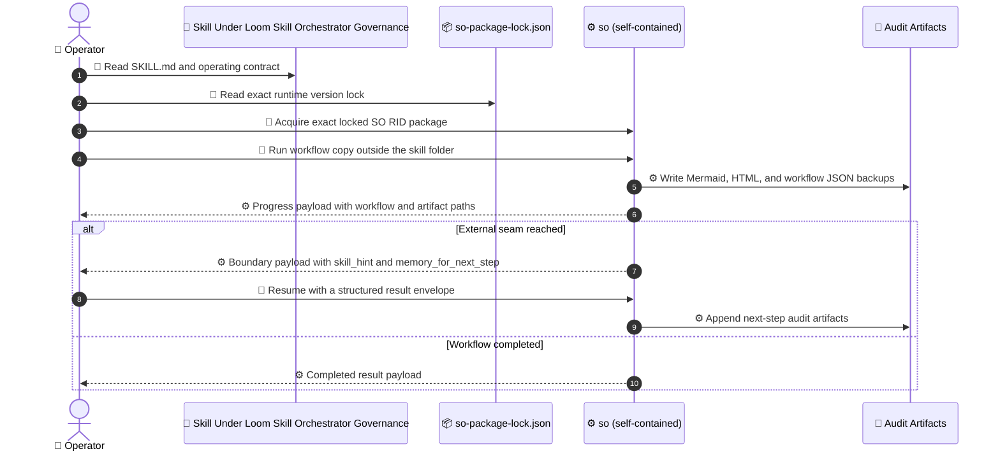
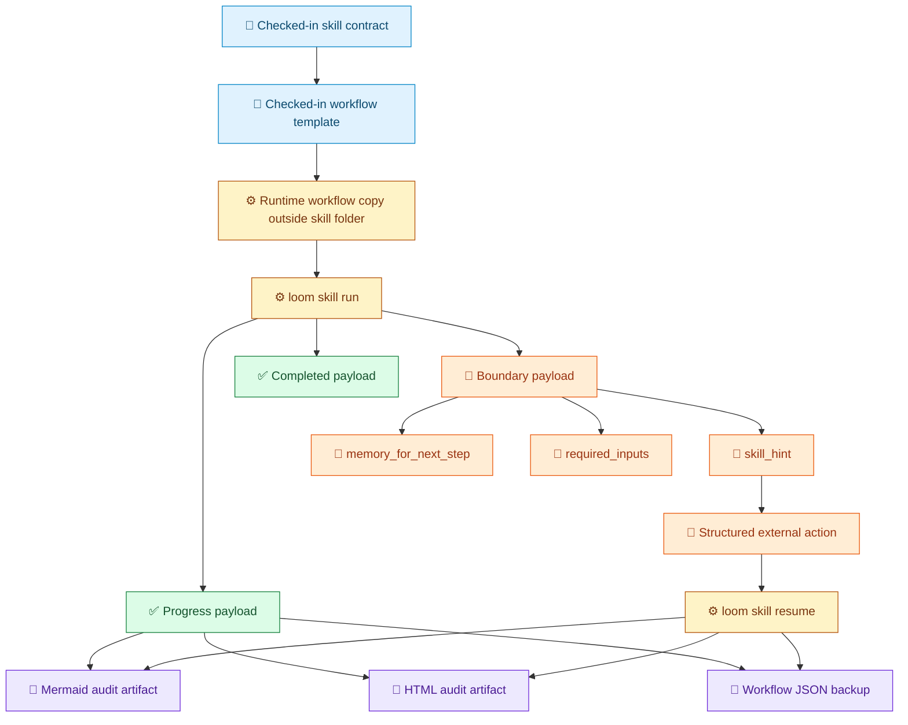

# Techne Loom

[中文](README.zh-CN.md)

<!-- release-notes:start -->
---

## 🚀 Release Notes · `v0.5.2-beta` · November 2026

> **beta release — synced by publish actions.**
> Install the single Loom runtime package matching the host RID; verify its `.sha512` sidecar before extraction.
> Full package list → [`packages.beta.md`](packages.beta.md)

### 📦 Packages In This Release

```text
Techne.Loom.Runtime.win-x64 0.5.2-beta
Techne.Loom.Runtime.win-arm64 0.5.2-beta
Techne.Loom.Runtime.linux-x64 0.5.2-beta
Techne.Loom.Runtime.linux-arm64 0.5.2-beta
Techne.Loom.Runtime.linux-musl-x64 0.5.2-beta
Techne.Loom.Runtime.linux-musl-arm64 0.5.2-beta
Techne.Loom.Runtime.osx-x64 0.5.2-beta
Techne.Loom.Runtime.osx-arm64 0.5.2-beta
Techne.Loom.Abstractions 0.5.2-beta
```

> The list is updated automatically after each channel publish. No floating package aliases are published.

### 🔭 Coming Next

- `loom-target-profile` and host capability profiles for paths, tools, hooks, permissions, and context mode
- Read-only host adapters with machine-readable semantic loss reports: `preserved`, `approximated`, `dropped`, and `unsafe`
- Activation, script, MCP, permission, runtime, and resume probes with a fixed cross-host conformance corpus
- Dependency/environment contracts plus signed package, SBOM, publisher-trust, and revocation evidence

> Node.js and Python remain reserved source roots only; no runnable implementation is committed yet.

---
<!-- release-notes:end -->


## Make Agent Skills Defensible In Production


> [!IMPORTANT]
> Techne Loom is a verifiable semantic and execution interoperability layer above Agent Skills.
> It reuses `SKILL.md`, `AGENTS.md`, and MCP, then adds explicit workflow contracts, runtime binding, governed run/resume, and evidence.

Skills are easy to share. Reliable execution across real hosts is not.

## Your Skill Needs Its Own Spine

<p align="center">
  
</p>

A skill should not rely entirely on the harness, runtime, or model that happens to execute it. Its workflow structure, persistent state, resume boundaries, and audit evidence should remain explicit, reviewable, and owned by the skill's workflow assets.

Today, the .NET-first Skill Orchestrator provides these mechanisms through checked-in workflow contracts, tracked runtime workflow copies, structured boundary payloads, and Mermaid, HTML, and workflow JSON evidence. Cross-host portability remains an ongoing direction, not a claim that every environment already behaves the same.

## Why Teams Get Stuck

Public issue reports across agent hosts show that a skill can fail before the model ever has a fair chance to use it:

- [Codex #15756](https://github.com/openai/codex/issues/15756) reports that a symlinked `SKILL.md` is silently omitted from discovery, while a symlinked directory is followed.
- [Claude Code #21428](https://github.com/anthropics/claude-code/issues/21428) reports user skills not being discovered and execution content remaining stale while autocomplete metadata changes.
- [Gemini CLI #29150](https://github.com/google-gemini/gemini-cli/issues/29150) reports case-sensitive precedence and active-state mismatches for otherwise identical skill names.
- [Agent Skills #514](https://github.com/agentskills/agentskills/issues/514) documents a mismatch between metadata prose, the reference validator, and a shipping runtime.
- [Agent Skills #485](https://github.com/agentskills/agentskills/issues/485) proposes machine-evaluable tool dependencies because a host may surface a skill even when its required tools are unavailable.
- [OpenCode #48400](https://github.com/anomalyco/opencode/issues/48400) asks for permissions that distinguish trusted global skills from project-local replacements.

These are different symptoms of one operational gap: the skill package, the host that discovers it, and the runtime that executes it do not always share one explicit meaning.

<p align="center">
  
</p>

Agents, models, harnesses, and runtimes will change. The durable question is whether the skill's contract, state, and evidence change with them.

## What Loom Adds

Loom does not promise to make every host behave the same. It makes the execution contract we control explicit, testable, and reviewable.

| Operational problem | Loom provides today | Product boundary |
| --- | --- | --- |
| Discovery, cache, and copy drift | Checked-in workflow contracts, exact runtime locks, external runtime workflow copies, and package/hash provenance evidence | Host materialization and cross-host adapters remain roadmap work |
| Implied steps and false completion | Explicit states, transitions, routes, seams, gates, ownership, output bindings, compile feedback, and semantic validation | Loom cannot force a model to activate or follow a skill |
| Missing tools or runtime mismatch | Exact package validation, direct apphost startup and guide capture, optional local stdio MCP bound to the current apphost identity, and bounded fragment inspection when needed | It is not a universal cross-host permission or sandbox standard |
| Interruption and handoff | Disk-backed state, wait/resume, operation identity, structured boundary payloads, event logs, and audit artifacts | A vendor chat transcript is not the source of truth |
| Review and provenance | Mermaid, HTML, workflow JSON, package/document hashes, and completion evidence | Signed packages, SBOM, and publisher trust are future supply-chain work |

## Why Bind the Loom Runtime to a Skill?

An agent plugin, a dedicated agent, and a Loom-governed Skill package different things:

| Approach | What it packages | Best fit |
| --- | --- | --- |
| Agent plugin | Host-specific commands, tools, hooks, UI, or integrations | Adding capabilities to a particular agent host |
| Dedicated agent | A specialist role, instructions, and host-supported model or tool settings | Providing a named agent with a distinct behavior or tool scope |
| Skill with Loom runtime | An agent-invocable business procedure, its workflow contract, and a lock for the exact runtime it uses | Reusing a multi-step procedure that needs persisted progress, explicit waits, resume, and reviewable evidence |

These are complementary boundaries, not competing implementations. A dedicated agent can invoke a Skill; a plugin can provide tools that the Skill's workflow calls. A workflow that runs as a back-end service without an agent-facing entry point may be better implemented as a service or scheduled job.

Here, “runtime in the Skill” means a declared and version-locked dependency, not runtime binaries stored inside the Skill folder. The Skill carries its checked-in workflow template and `assets/so-workflow/so-package-lock.json`, which identifies the exact runtime package, version, target RID, and expected hash. The verified package is reused from the current user's OS temporary cache. Each run's mutable workflow copy and audit records live outside the checked-in Skill folder.

This boundary lets the Skill declare which workflow and runtime version belong together, while the self-contained Loom apphost executes and persists each run outside the host agent's chat state. The host still controls Skill discovery, invocation, permissions, and available tools; this does not guarantee that every host can run the Skill. Use a host plugin when Loom needs host-native integration, and bind Loom as a Skill dependency when the product to deliver is an agent-invoked, governed business workflow.

## The Product To Adopt First

Start with `/loom-skill-enhancement`.

It turns a prompt-shaped skill into a governed production asset while keeping the original Agent Skill envelope intact.

It gives a team a skill that can:

- carry a checked-in workflow contract
- lock the exact product+RID runtime package it depends on
- run from a tracked workflow copy outside the skill folder
- stop with a strict boundary payload instead of vague prose
- resume with structured inputs instead of conversational guesswork
- emit Mermaid, HTML, and workflow JSON artifacts for review and audit

Adoption gives teams control.

> Design direction, not a portability guarantee: Loom aims to preserve a skill's contract, state, and evidence as environments change. It does not yet promise host-independent execution.

<p align="center">
  
</p>

That is the design direction: build a skill's durable spine while treating host portability and runtime independence as explicit engineering boundaries.

## Unenhanced Skill Vs Skill Under Loom Skill Orchestrator Governance

| Dimension | Unenhanced skill | skill under Loom Skill Orchestrator governance |
| --- | --- | --- |
| workflow control | implied in prompt behavior | checked-in workflow contract |
| runtime dependency | assumed or loosely documented | exact bundle lock in `so-package-lock.json` |
| mutable execution state | scattered across chat and operator memory | tracked runtime workflow copy |
| interruption handling | ad hoc retry or re-prompt | explicit boundary and structured resume |
| auditability | reconstructed after the fact | emitted step artifacts during execution |
| operator trust | personality-driven | contract-driven |

## When Agent Skills Go Wrong: Long-Running Execution Loses Its State

The problem is not only that an agent can make a mistake. During a long task, it may retain the ability to act while losing track of what it was asked to do, what it has already completed, or which parts of a Skill's instructions still apply.

> [!NOTE]
> The following are public reports by issue authors about particular products and sessions, not independent forensic findings or claims that every host behaves this way.

### 1. The Plan Survived; the Execution State Did Not

**Codex · August 2026 · user-reported context-compaction issue**

[Codex #38931](https://github.com/openai/codex/issues/38931) describes a long-running investigation where, after context compaction, the earlier plan was still present but completed work was no longer clearly distinguished from pending work. The author reports that Codex started repeating investigation steps that had already been performed.

**Failure boundary:** A plan describes intended work; it does not record which steps actually finished.

**Loom mechanism:** The canonical runtime workflow copy is a JSON file outside the checked-in skill folder. It records the current step, overall status, context, execution history, and pending waits. `loom skill run` and `resume` load the same file; each execution saves updated state through a same-directory temporary file and appends an event to `<workflow-file>.events.jsonl`. The current position comes from that persisted state, not a chat-summary estimate.

### 2. Skill Instructions Were Summarized Without Their Key Details

**Claude Code · July 2026 · user-reported Skill fidelity issue**

In [Claude Code #73280](https://github.com/anthropics/claude-code/issues/73280), the author reports that context compaction summarized Skill instructions injected into a long-running session, omitting specific output-format and operational constraints. This describes the reported session; it does not establish how all hosts handle Skill instructions.

**Failure boundary:** A plausible summary of a Skill is not necessarily a faithful copy of its requirements.

**Loom mechanism:** The checked-in workflow template under `assets/so-workflow/` is the durable source for modeled steps, routes, required inputs, and gates; execution uses an external copy of that workflow. Constraints that must survive compaction need to be represented in the workflow explicitly. Loom does not copy every `SKILL.md` instruction into runtime state or force a host to reload the full Skill.

### 3. An Existing Tool and Required Workflow Steps Were Bypassed

**Claude Code · July 2026 · user-reported workflow-adherence issue**

[Claude Code #75922](https://github.com/anthropics/claude-code/issues/75922) reports that an agent reimplemented work instead of using an existing repository tool, skipped an upstream workflow step, and repeated the same class of mistake after correction.

**Failure boundary:** Producing a plausible result is not the same as following the required workflow.

**Loom mechanism:** Put required ordering in workflow nodes and transitions, not only in Skill prose. Compile checks the declared structure and expressions; `run` advances the persisted instance and records its history. This governs the route executed through Loom, but cannot stop a host agent from taking an out-of-workflow action.

### 4. “Done” Was Reported Without Required Tests

**Claude Code · May 2026 · user-reported completion-verification issue**

In [Claude Code #60177](https://github.com/anthropics/claude-code/issues/60177), a user describes a project spanning about 12 days and 51 commits, where the agent repeatedly claimed work was ready without performing the required tests. Project instructions and hooks called for verification, but the report says those requirements did not reliably translate into tested completion.

**Failure boundary:** An agent's completion claim is not evidence that the required test passed.

**Loom mechanism:** A test can gate completion only if its validator is actually invoked by the workflow or its structured result is supplied at a declared seam. The runtime validates the returned payload against declared fields before applying it and records the resulting workflow state; it does not independently prove that an external test really ran or automatically execute arbitrary repository tests.

> **The plan survived. The execution state did not.** Having the right tools is not the same as following the right workflow, and claiming completion is not completion evidence.

### The Common Failure: Execution Without a Defensible Contract

| Failure boundary | Reported consequence | Needed control |
| --- | --- | --- |
| Execution state | Completed work reappeared after context compaction | Persisted step status and completion evidence |
| Skill fidelity | Specific instructions were reportedly omitted from a compaction summary | Explicit workflow contract and host-side Skill reload or validation |
| Workflow adherence | Existing tools or required steps were reportedly bypassed | Declared routes and validated transition gates |
| Completion | “Done” was reported without required tests | Gate completion on results from an integrated validator |

### Where Techne Loom Fits

Techne Loom addresses workflow governance: through `/loom-skill-enhancement` and Skill Orchestrator, it provides:

- **Explicit workflow contracts:** States, transitions, routes, gates, and ownership are declared outside improvised conversation flow.
- **Structured handoff seams:** A workflow can stop for external work and resume with structured inputs that the runtime validates.
- **Persistent execution context:** The canonical workflow JSON copy outside the skill folder stores the current step, status, context, history, and pending waits. `run` and `resume` reload that same copy; an adjacent `.events.jsonl` sidecar records execution events.
- **Reviewable records:** Event records, Mermaid and HTML views, and workflow JSON backups make recorded execution state easier to inspect.
- **Declared runtime dependencies:** Exact runtime locks and package verification reduce ambiguity about which runtime was acquired.

These controls apply only to steps represented and validated by a Loom workflow. Loom does not automatically reload arbitrary `CLAUDE.md`, `AGENTS.md`, or Skill files after host compaction, prevent out-of-workflow host actions, or prove that a test or command succeeded unless an integration actually runs and validates it. Loom does not provide universal tool-permission enforcement, database isolation, transactional rollback, guaranteed interception of every agent command, or automatic traceability for arbitrary subagent activity. Those controls belong to the host, execution environment, and external enforcement systems.

**The goal is not to promise that an agent will never make a mistake. It is to stop treating an agent's confidence as proof of correct execution.**

## In One Line

**`/loom-skill-enhancement` provides a structured path from prompt-shaped skill behavior to governed, reviewable execution, with explicit limits on what Loom itself enforces.**

## The Release Story

Today, the major released path is:

1. **SO as the deterministic runtime**
2. **skills under Loom Skill Orchestrator governance as the operator-facing product**
3. **Tracked, audit-first execution as the default model**

Loom Agent Plan-Execution Orchestrator and `/loom-plan-execution` still matter. They currently belong in the beta exploratory layer.

## What A Skill Under Loom Skill Orchestrator Governance Ships With

A skill under Loom Skill Orchestrator governance ships with:

- a checked-in `SKILL.md`
- a checked-in workflow template under `assets/so-workflow/`
- an authoritative runtime lock file at `assets/so-workflow/so-package-lock.json`
- deterministic `loom skill run` and `loom skill resume` execution (self-contained direct entry)
- Mermaid, HTML, and workflow JSON audit artifacts for each step
- strict boundary payloads with `skill_hint`, `memory_for_next_step`, and required continuation inputs

## Start Fast

### Run A Released Skill Under Loom Skill Orchestrator Governance

1. Start from [packages.released.md](packages.released.md).
2. Acquire the released SO self-contained package that matches the host RID from the exact package index; do not restore the retired core-project bundle.
3. Open the target skill's `SKILL.md`.
4. Read `assets/so-workflow/so-package-lock.json`.
5. Read `so-package-lock.json`, acquire the one exact SO product+RID package, and validate its hash and archive before extraction.
6. Clone the checked-in workflow template to a runtime workflow copy outside the skill folder.
7. Run `loom skill run --workflow-file <runtime-copy-path>`.
8. If blocked, follow `skill_hint` and continue with `loom skill resume --workflow-file <runtime-copy-path> --result-file <path>`.

```text
Read SKILL.md -> read so-package-lock.json -> acquire exact SO RID package -> clone workflow template -> loom skill run -> inspect audit artifacts -> loom skill resume
```

### Create Or Upgrade A Released Skill Under Loom Skill Orchestrator Governance

1. Start from [packages.released.md](packages.released.md) for stable work.
2. Use `/loom-skill-enhancement`.
3. Read [Using Techne Loom Skills](docs/en/guides/skill-usage.md).
4. Read [SkillOrchestrator Guide](docs/en/guides/so-guide.md).
5. Let the enhancement flow produce the checked-in workflow assets and runtime lock.

```text
/loom-skill-enhancement -> review skill-plan -> review workflow template -> review runtime lock -> run the enhanced skill with `so`
```

## How Governed Execution Stays On Track

Legend: `👤` operator action, `🧩` skill surface, `📦` runtime lock, `⚙️` runtime execution, `🧾` audit evidence.



Execution stays on track because the next step is explicit, the mutable workflow copy is persisted, and the resume boundary is structured instead of improvised.

## How The Skill Holds Up Under Audit

A skill under Loom Skill Orchestrator governance is not only executable. It is inspectable under pressure.

Every serious step can leave:

- a Mermaid rendering of the point-in-time workflow
- an HTML rendering for human inspection
- a workflow JSON backup for exact replay context
- boundary payloads that show why the skill stopped and what it needed next

Legend: `📜` checked-in contract, `⚙️` runtime execution, `✅` progress or completion output, `🚧` boundary state, `🔁` continuation action, `🧾` audit evidence.



That means operator questions are answered with artifacts instead of memory:

- What exact step did the skill stop at?
- Why did it stop?
- What input resumed it?
- What workflow shape existed at that point?

## Pick The Path That Matches Your Situation

| If you want to... | Start from... | What it means | Example |
| --- | --- | --- | --- |
| run a skill that has already been enhanced and released | a released skill under Loom Skill Orchestrator governance | the skill already has its checked-in workflow assets and runtime lock | Example: "Run this released skill. If it blocks and needs my input, ask me first. If you can resolve it, continue the resume flow." |
| turn your own skill into something releasable and governed | your target skill with `/loom-skill-enhancement` | this is the path that generates the future version under Loom Skill Orchestrator governance of your skill | Example: "Enhance this skill with /loom-skill-enhancement, create the workflow template, and let me review it with friendly output." |
| explore a route before the workflow is stable | `/loom-plan-execution` | this is still the beta Loom Agent Plan-Execution Orchestrator exploratory layer | Example: "Use /loom-plan-execution to translate the full plan we already made into a workflow, then use that workflow to track the run until the final successful outcome is generated." |

Read first:

- released skill run: [Using Techne Loom Skills](docs/en/guides/skill-usage.md)
- skill enhancement path: [Using Techne Loom Skills](docs/en/guides/skill-usage.md), then [Skill Orchestrator Guide](docs/en/guides/so-guide.md)
- beta exploration path: [Loom Agent Plan-Execution Orchestrator Guide](docs/en/guides/ao-guide.md)

## Stable Operating Rules

1. Direct CLI or manual package acquisition chooses package channel first; for a skill under Loom Skill Orchestrator governance, follow the runtime version bound by the current CI/CD-managed skill package version block or checked-in runtime lock.
2. Direct stable/manual skill runs default to [packages.released.md](packages.released.md); direct prerelease/manual runs default to [packages.beta.md](packages.beta.md).
3. Acquire and validate the one exact product+RID runtime package; do not assemble a multi-package DLL runtime closure.
4. Keep runtime workflow copies, session state, event sidecars, and audit artifacts outside checked-in skill folders.
5. Treat the checked-in skill workflow template as immutable source.
6. Treat checked-in `SKILL.md`, `contract.json`, and `assets/so-workflow/` surfaces as the normative governance contract. Treat demo timelines and recorded-slice narratives as historical records: they explain what happened in a slice, but they do not redefine the current governed completion contract unless the normative target-skill assets say so.

## Official Guides

Use these guide surfaces as the operator contract:

- `loom --guide` (self-contained direct entry)
- [Using Techne Loom Skills](docs/en/guides/skill-usage.md)
- [SkillOrchestrator Guide](docs/en/guides/so-guide.md)
- [Skill Under Loom Skill Orchestrator Governance Run Example](docs/en/examples/so-enhanced-skill-run.md)
- [Skills Input/Output Reference](docs/en/reference/skills.md)

## Loom Agent Plan-Execution Orchestrator Remains Beta

Loom Agent Plan-Execution Orchestrator and `/loom-plan-execution` remain important, but they belong to the beta exploratory layer.

Use Loom Agent Plan-Execution Orchestrator when:

- the route is still unclear
- the top-level agent needs to compare frontiers
- the workflow is not yet stable enough to become a deterministic skill

Read Loom Agent Plan-Execution Orchestrator through these beta surfaces:

- [Loom Agent Plan-Execution Orchestrator Guide](docs/en/guides/ao-guide.md)
- [Loom Agent Plan-Execution Orchestrator CLI Usage](docs/en/guides/ao-cli-usage.md) | [Skill Orchestrator CLI Usage](docs/en/guides/so-cli-usage.md)
- [Agent Integration](docs/en/guides/agent-integration.md)

## C# / .NET First · Self-Contained Cross-Platform

| Surface | Active release package |
| --- | --- |
| Unified Loom runtime | `Techne.Loom.Runtime.<rid>` (8 supported RIDs; one `loom` apphost) |
| Contract SDK | `Techne.Loom.Abstractions` (no RID) |

The active release closure contains eight self-contained runtime packages and one no-RID Abstractions SDK. AO and SO remain independent implementation modules, not separate runtime package families. Node.js (`src/nodejs`) and Python (`src/python`) remain reserved source roots without runnable runtimes.

Select the exact self-contained runtime package for the detected host RID. Verify package identity, version, SHA-512, manifest, archive safety, apphost, and guide files before running the extracted `loom` apphost. The same binary exposes `loom agent` and `loom skill`; standalone questions use only `loom ask`. See [Platform Detection Steps](docs/en/reference/runtime/platform-detection.md) and the [released package index](packages.released.md).

## Runtime Package Family

The unified runtime family contains one self-contained package for each supported RID, plus the no-RID `Techne.Loom.Abstractions` contract SDK at the same exact version and channel. Each runtime package contains one `loom.exe` apphost on Windows or one `loom` apphost on Unix-like systems, with the version-matched English guides.

| RID | Runtime package | Apphost path |
| --- | --- | --- |
| `win-x64` | `Techne.Loom.Runtime.win-x64` | `tools/win-x64/loom.exe` |
| `win-arm64` | `Techne.Loom.Runtime.win-arm64` | `tools/win-arm64/loom.exe` |
| `linux-x64` | `Techne.Loom.Runtime.linux-x64` | `tools/linux-x64/loom` |
| `linux-arm64` | `Techne.Loom.Runtime.linux-arm64` | `tools/linux-arm64/loom` |
| `linux-musl-x64` | `Techne.Loom.Runtime.linux-musl-x64` | `tools/linux-musl-x64/loom` |
| `linux-musl-arm64` | `Techne.Loom.Runtime.linux-musl-arm64` | `tools/linux-musl-arm64/loom` |
| `osx-x64` | `Techne.Loom.Runtime.osx-x64` | `tools/osx-x64/loom` |
| `osx-arm64` | `Techne.Loom.Runtime.osx-arm64` | `tools/osx-arm64/loom` |

The complete release contains eight RID runtime packages plus one no-RID SDK (nine packages total). Stable GitHub fallback aliases follow the `nuget-stable-latest` release; beta uses `nuget-beta-latest`. Use NuGet.org V3 flat-container URLs or exact-version GitHub assets as documented in [packages.released.md](packages.released.md).

GitHub exact-version package and checksum shape (use `nuget-beta-latest` for beta):

```text
https://github.com/waynebaby/Techne-Loom/releases/download/nuget-stable-latest/<PackageId>.<exact-version>.nupkg
https://github.com/waynebaby/Techne-Loom/releases/download/nuget-stable-latest/<PackageId>.<exact-version>.nupkg.sha512
```

```text
https://api.nuget.org/v3-flatcontainer/<lowercased-package-id>/<normalized-exact-version>/<lowercased-package-id>.<normalized-exact-version>.nupkg
```

## Direct Apphost Invocation

Use the exact `Techne.Loom.Runtime.<rid>` package for the detected RID. The module command is selected after starting the single apphost:

```text
Windows: .\loom.exe agent run --workflow-file <workflow-path>
Windows: .\loom.exe skill run --workflow-file <workflow-path>
Windows: .\loom.exe ask start --contract-file <contract-path>
Windows: .\loom.exe --guide
Unix: ./loom agent run --workflow-file <workflow-path>
Unix: ./loom skill run --workflow-file <workflow-path>
Unix: ./loom ask start --contract-file <contract-path>
Unix: ./loom --guide
```

There is no shared-host DLL launch mode. Follow the package index and platform-detection guide for exact package selection and validation.
## Read Next

- [Using Techne Loom Skills](docs/en/guides/skill-usage.md)
- [Skill Orchestrator Guide](docs/en/guides/so-guide.md)
- [Skill Under Loom Skill Orchestrator Governance Run Example](docs/en/examples/so-enhanced-skill-run.md)
- [Demo Index](demos/README.md)
- [loom-enhanced-research Demo Timeline](demos/loom-enhanced-research/README.md)
- [Skills Input/Output Reference](docs/en/reference/skills.md)
- [Loom Agent Plan-Execution Orchestrator Guide](docs/en/guides/ao-guide.md)
- [AGENTS.md](AGENTS.md)

Techne Loom is not trying to make agent systems sound magical.
It is trying to make skills under Loom Skill Orchestrator governance hard to dismiss.
