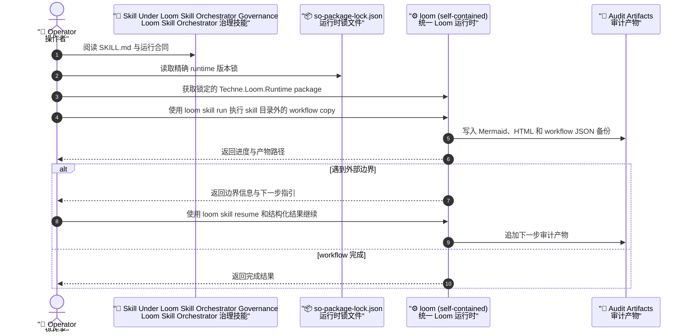
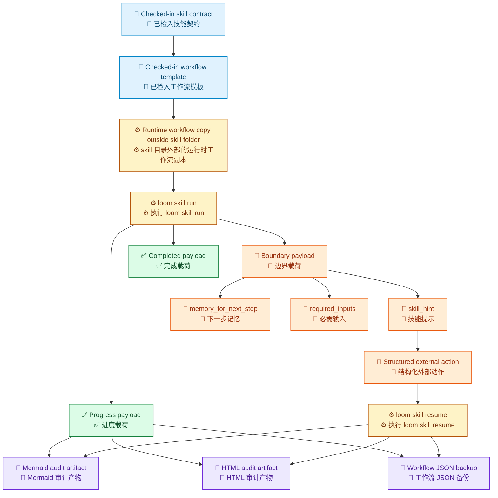

# Techne Loom

[English](README.md)

<!-- release-notes:start -->
---

## 🚀 发布说明 · `v0.5.4-beta` · 2026 年 11 月

> **beta 发布版本 — 由发布工作流自动同步。**
> 请选择与主机 RID 匹配的统一 Loom runtime package，并在解压前校验 `.sha512` sidecar。
> 完整包列表 → [`packages.beta.zh-CN.md`](packages.beta.zh-CN.md)

### 📦 本次发布的包

```text
Techne.Loom.Runtime.win-x64 0.5.4-beta
Techne.Loom.Runtime.win-arm64 0.5.4-beta
Techne.Loom.Runtime.linux-x64 0.5.4-beta
Techne.Loom.Runtime.linux-arm64 0.5.4-beta
Techne.Loom.Runtime.linux-musl-x64 0.5.4-beta
Techne.Loom.Runtime.linux-musl-arm64 0.5.4-beta
Techne.Loom.Runtime.osx-x64 0.5.4-beta
Techne.Loom.Runtime.osx-arm64 0.5.4-beta
Techne.Loom.Abstractions 0.5.4-beta
```

> 本清单会在每次对应通道发布后自动更新，不再发布浮动包别名。

### 🔭 即将推出

- `loom-target-profile` 与覆盖 paths、tools、hooks、permissions、context mode 的 host capability profile
- 带机器可读 semantic loss report 的只读 host adapter：`preserved`、`approximated`、`dropped`、`unsafe`
- activation、script、MCP、permission、runtime 与 resume probes，以及固定的跨宿主 conformance corpus
- dependency/environment contract，以及 signed package、SBOM、publisher-trust 与 revocation 证据

> Node.js 与 Python 目前仅作为预留 source root；尚未提交可运行的实现。

---
<!-- release-notes:end -->


## 让 Agent Skills 在生产中站得住


> [!IMPORTANT]
> Techne Loom 是构建在 Agent Skills 之上的可验证语义与执行互操作层。
> 它复用 `SKILL.md`、`AGENTS.md` 和 MCP，再增加显式 workflow 合同、runtime binding、受治理的 run/resume 与可复核证据。

Skill 很容易分享；让它在真实宿主中可靠运行，却并不容易。

## 你的 Skill 需要自己的工程脊柱

<p align="center">
  
</p>

Skill 不应该完全依赖恰好执行它的 harness、runtime 或 model。它的工作流结构、持久状态、恢复边界和审计证据，都应该由 Skill 的 workflow 资产显式承载、可复核并保持可追踪。

当前 .NET-first Skill Orchestrator 通过 checked-in workflow 合同、tracked runtime workflow copy、结构化 boundary payload，以及 Mermaid、HTML 和 workflow JSON 证据提供这些机制。具备 CLI 或 MCP 调用能力并可访问兼容 Loom apphost 的 Agent，可以调用同一套 workflow 执行合同；Skill 的发现、加载与权限仍由宿主决定。

## 团队为什么会卡住

不同 Agent 宿主的公开 issue 反复显示：Skill 可能在模型获得使用机会之前，就已经在加载、解析或运行环境这一层失败了：

- [Codex #15756](https://github.com/openai/codex/issues/15756) 报告文件级 `SKILL.md` symlink 会被静默跳过，而目录 symlink 会被跟随。
- [Claude Code #21428](https://github.com/anthropics/claude-code/issues/21428) 报告用户 Skill 无法发现，以及 autocomplete 元数据更新后实际执行内容仍然是旧缓存。
- [Gemini CLI #29150](https://github.com/google-gemini/gemini-cli/issues/29150) 报告同名 Skill 仅因大小写不同，就出现优先级和 active 状态不一致。
- [Agent Skills #514](https://github.com/agentskills/agentskills/issues/514) 记录了 metadata 规范文字、参考 validator 与已发布 runtime 之间的语义不一致。
- [Agent Skills #485](https://github.com/agentskills/agentskills/issues/485) 提议机器可判定的工具依赖，因为宿主可能展示一个当前缺少必需工具的 Skill。
- [OpenCode #48400](https://github.com/anomalyco/opencode/issues/48400) 要求权限策略能够区分可信的全局 Skill 与项目目录提供的替代版本。

这些报告从不同侧面呈现同一个运行鸿沟：Skill package、发现它的宿主与实际执行它的 runtime，可能缺少一份共同的显式语义。

<p align="center">
  
</p>

代理、模型、harness 和 runtime 都会变化。真正需要持续的是 Skill 的合同、状态和证据，而不是某一次执行环境的外壳。

## Loom 增加什么

Loom 不承诺让所有宿主表现得一模一样。它把我们能够控制的执行合同变成显式、可测试、可复核的东西。

| 运行问题 | Loom 当前提供 | 产品边界 |
| --- | --- | --- |
| 发现、缓存和副本漂移 | checked-in workflow 合同、精确 runtime lock、skill 目录外的 runtime workflow copy，以及 package/hash provenance 证据 | 宿主侧 Skill 发现、实例化和原生 adapter 仍需按宿主适配；CLI/MCP 可调用同一 Loom runtime |
| 隐含步骤和假完成 | 显式 states、transitions、routes、seams、gates、ownership、output bindings、compile feedback 与语义校验 | Loom 不能强迫模型激活或遵循某个 Skill |
| 工具缺失或 runtime 不匹配 | 精确 package 校验、direct apphost 启动与 guide capture、绑定当前 apphost identity 的可选本地 stdio MCP，以及按需进行的有界 fragment inspection | 它不是统一所有宿主权限或 sandbox 的标准 |
| 中断与交接 | 磁盘上的状态、wait/resume、operation identity、结构化 boundary payload、event log 与审计产物 | 厂商聊天 transcript 不是事实源 |
| 复核与 provenance | Mermaid、HTML、workflow JSON、package/document hash 与 completion evidence | signed package、SBOM 和 publisher trust 属于后续供应链工作 |

## 为什么把 Loom Runtime 作为 Skill 的依赖？

Agent 插件、专用 Agent 与绑定 Loom runtime 的 Skill，分别承载不同层次：

| 方式 | 封装的内容 | 适用场景 |
| --- | --- | --- |
| Agent 插件 | 宿主专属命令、工具、钩子、界面或集成 | 为某个 Agent 宿主增加专属能力 |
| 专用 Agent | 专业角色、指令，以及宿主支持的模型或工具设置 | 提供行为方式或工具范围明确的专职 Agent |
| 绑定 Loom runtime 的 Skill | 可由 Agent 调用的业务规程、workflow 合同，以及所依赖 runtime 的版本锁 | 复用需要持久进度、显式等待、恢复和可复核证据的多步骤流程 |

三者职责各异，可以组合使用。专用 Agent 可以调用 Skill，插件可以为 Skill workflow 暴露宿主原生工具。由后台触发、通过服务接口运行的流程，更适合实现为服务或定时任务。

Skill 通过版本锁声明 runtime 依赖，并携带已检入的 workflow template 和 `assets/so-workflow/so-package-lock.json`。锁文件标明精确的 runtime package、版本、目标 RID 和预期 hash。通过验证的 package 会复用当前用户 OS 临时目录中的缓存。Skill 目录保存 workflow template 和锁文件；每次运行的可变 workflow 副本与审计记录保存在该目录之外。

同一套 Loom workflow 可以通过 CLI 或 MCP 接入 DeepSeek、Codex、Claude 等兼容 Agent，团队围绕一份业务流程和执行合同维护。只要宿主允许 CLI 或 MCP 调用，并能访问兼容的 Loom apphost，就可以调用这套 workflow。Agent 负责用户交互并发起调用；Loom apphost 负责执行 workflow 状态转换、校验输入、持久化运行状态、处理 wait/resume，并生成事件证据。各宿主的 Agent runtime 可以不同，workflow 的执行合同仍由 Loom 统一管理。

宿主继续控制 Skill 的发现和调用、工具与进程权限，以及调用生命周期和中断。Loom 在宿主授予的边界内执行。跨宿主复用依赖于 CLI 或 MCP 支持，以及对兼容 apphost 的访问。需要宿主原生集成时使用插件；需要让多个兼容宿主调用同一套持久化业务 workflow 时，将 Loom runtime 声明为 Skill 依赖。

## 第一件该采用的产品

先采用 `/loom-skill-enhancement`。

它会在保留原有 Agent Skill envelope 的同时，把 prompt 形态的 skill 改造成可治理的生产资产。

它会让团队拿到这样一种 skill：

- 带 checked-in workflow 合同
- 为它依赖的精确 product+RID runtime package 加锁
- 从 skill 目录外部的 tracked workflow copy 运行
- 在外部 seam 处返回严格 boundary payload
- 用结构化输入 resume
- 自动产出 Mermaid、HTML 和 workflow JSON 审计产物

采用它，团队拿到的是控制力。

> 这是设计方向，不是现成的跨宿主保证：Loom 希望在环境变化时保留 Skill 的合同、状态和证据，但目前并不承诺脱离宿主独立执行。

<p align="center">
  
</p>

这是一条工程方向：让 Skill 拥有可持续的脊柱，同时把宿主互操作性和 runtime 独立性明确当作需要持续建设的边界。

## 未增强 Skill 与 Skill Under Loom Skill Orchestrator Governance 的差别

| 维度 | 未增强 skill | skill under Loom Skill Orchestrator governance |
| --- | --- | --- |
| workflow 控制 | 藏在 prompt 行为里 | checked-in workflow 合同 |
| runtime 依赖 | 靠约定或零散文档 | `so-package-lock.json` 精确锁定 |
| 可变执行状态 | 散落在聊天和操作者记忆里 | tracked runtime workflow copy |
| 中断处理 | 临时 retry 或重提示 | 显式 boundary 与结构化 resume |
| 审计能力 | 事后拼凑 | 执行过程中持续产出 artifacts |
| 操作者信任 | 靠人格化表现 | 靠合同化行为 |

## Agent Skill 出问题时：长期执行中的状态丢失

长期任务中，Agent 可能仍保有操作能力，却逐渐失去对任务目标、已完成步骤以及 Skill 指令适用范围的把握。

> [!NOTE]
> 以下是 issue 提交者针对特定产品和会话的公开报告，并非独立取证结论，也不代表所有宿主都会出现相同行为。

### 1. 计划还在，执行状态却丢了

**Codex · 2026 年 8 月 · 用户报告的上下文压缩问题**

[Codex #38931](https://github.com/openai/codex/issues/38931) 描述了一项长期调查：上下文压缩后，原有计划仍然存在，但已完成与待执行工作不再明确区分。提交者称，Codex 因而重新开始已经做过的调查步骤。

**失效边界：** 计划描述准备做什么，却不记录哪些步骤实际已经完成。

**Loom 的具体机制：** canonical runtime workflow 副本是放在已检入 Skill 目录之外的 JSON 文件，记录当前步骤、整体状态、上下文、执行历史和待处理等待。`loom skill run` 与 `resume` 读取同一文件；每次执行后，runtime 先写入同目录临时文件再替换原文件，并向 `<workflow-file>.events.jsonl` 追加事件。恢复位置来自这份持久状态，而不是聊天摘要中的进度估算。

### 2. Skill 指令被压缩摘要遗漏了关键细节

**Claude Code · 2026 年 7 月 · 用户报告的 Skill 指令保真问题**

在 [Claude Code #73280](https://github.com/anthropics/claude-code/issues/73280) 中，提交者称长期会话的上下文压缩将注入会话的 Skill 指令概括成摘要，并遗漏具体输出格式和操作约束。该报告描述的是特定会话，不能据此推断所有宿主对 Skill 指令的处理方式。

**失效边界：** 看似合理的 Skill 摘要，不一定忠实保留了原始要求。

**Loom 的具体机制：** `assets/so-workflow/` 下已检入的 workflow template 是步骤、路由、必需输入和门禁的持久来源；执行时使用目录外的 workflow 副本。需要跨压缩保留的约束必须显式写入工作流。Loom 不会把 `SKILL.md` 的所有原文自动复制进运行状态，也不会强制宿主重新加载完整 Skill。

### 3. 绕过了既有工具和必需的工作流步骤

**Claude Code · 2026 年 7 月 · 用户报告的工作流遵循问题**

[Claude Code #75922](https://github.com/anthropics/claude-code/issues/75922) 报告称，Agent 没有使用仓库中已有的工具，而是重新实现功能；同时跳过了上游必需步骤，并在用户纠正后重复同类错误。

**失效边界：** 产出看似合理的结果，不等于遵循了规定的工作流。

**Loom 的具体机制：** 将必须遵守的步骤顺序写入 workflow 节点和转换。Compile 会检查声明的结构与表达式；`run` 按持久化实例推进并记录历史。这些机制约束经 Loom 执行的路径，宿主 Agent 仍可在 workflow 之外采取操作。

### 4. 未运行必需测试便宣称“完成”

**Claude Code · 2026 年 5 月 · 用户报告的完成验证问题**

在 [Claude Code #60177](https://github.com/anthropics/claude-code/issues/60177) 中，用户描述了一个历时约 12 天、包含 51 次提交的项目：Agent 多次在没有执行必需测试时就称工作已准备就绪。项目指令和 hooks 虽然要求验证，但报告称这些要求并未稳定地转化为测试通过后的完成状态。

**失效边界：** Agent 声称完成，并不能证明必需测试已经通过。

**Loom 的具体机制：** 只有当测试验证器确实由工作流调用，或其结构化结果从已声明的边界提交时，测试结果才能作为完成门槛。Runtime 会在应用结果前按声明字段校验载荷，并记录更新后的工作流状态；它不会独立证明外部测试确实运行过，也不会自动执行任意仓库测试。

> **计划还在，执行状态却不在。** 有正确工具不等于遵循了正确工作流；声称完成也不等于完成证据。

### 共同失效：缺少可辩护的执行合同

| 失效边界 | 报告中的后果 | 所需控制 |
| --- | --- | --- |
| 执行状态 | 上下文压缩后已完成的工作再次出现 | 持久化步骤状态和完成证据 |
| Skill 指令保真 | Skill 具体要求据报从压缩摘要中遗漏 | 显式工作流合同，以及由宿主重新加载或校验 Skill |
| 工作流遵循 | 既有工具或必需步骤据报遭到绕过 | 声明路由并校验状态转换 |
| 完成判定 | 未运行必需测试便宣称“完成” | 仅在已接入的验证器返回结果后完成 |

### Techne Loom 能解决问题的哪一部分

Techne Loom 处理的是工作流治理：通过 `/loom-skill-enhancement` 和 Skill Orchestrator，它提供：

- **显式工作流合同：** 在临时对话流程之外声明状态、转换、路由、门禁和操作归属。
- **结构化交接边界：** 工作流可在外部操作处暂停，并用 runtime 校验过的结构化输入恢复。
- **持久执行上下文：** skill 目录外的 canonical workflow JSON 副本保存当前步骤、状态、上下文、历史和待处理等待。`run` 与 `resume` 读取同一副本；旁边的 `.events.jsonl` sidecar 追加记录执行事件。
- **可复核记录：** event 记录、Mermaid 与 HTML 视图、workflow JSON 备份便于检查已记录的执行状态。
- **明确的 runtime 依赖：** 精确 runtime lock 和 package 校验减少对实际获取运行时的歧义。

这些控制只适用于已写入 Loom 工作流并经过验证的步骤。Loom 不会在宿主压缩上下文后自动重新加载任意 `CLAUDE.md`、`AGENTS.md` 或 Skill 文件，不会阻止宿主绕过工作流执行操作；除非集成确实运行并校验测试或命令结果，否则 Loom 也不能证明它们已经成功。Loom 不提供通用工具权限强制、数据库隔离、事务回滚、对每条 agent 命令的保证拦截，也不会自动追踪任意子 agent 活动。这些控制必须由宿主、执行环境或外部强制机制提供。

**Loom 通过持久状态与可复核证据，帮助团队检查实际执行情况。**

## 一句话

**`/loom-skill-enhancement` 为 prompt 形态的 skill 提供结构化治理与复核路径，同时明确 Loom 自身强制能力的边界。**

## 当前的发布故事

今天最重要的发布路径是：

1. **SO 作为确定型 runtime**
2. **skill under Loom Skill Orchestrator governance 作为操作者面对的产品**
3. **以跟踪和审计优先为默认值的执行模型**

Loom Agent Plan-Execution Orchestrator 和 `/loom-plan-execution` 仍然重要。它们现在属于 beta 探索层。

## 一个 Skill Under Loom Skill Orchestrator Governance 交付什么

一个 skill under Loom Skill Orchestrator governance 会连同这些资产一起交付：

- checked-in 的 `SKILL.md`
- `assets/so-workflow/` 下的 checked-in workflow template
- 权威运行时锁文件 `assets/so-workflow/so-package-lock.json`
- 确定型的 `loom skill run` 与 `loom skill resume`（self-contained 直接入口）
- 每一步的 Mermaid、HTML、workflow JSON 审计产物
- 带 `skill_hint`、`memory_for_next_step` 和 required continuation inputs 的严格 boundary payload

## 快速开始

### 运行一个已发布的 Skill Under Loom Skill Orchestrator Governance

1. 从 [packages.released.zh-CN.md](packages.released.zh-CN.md) 开始。
2. 从对应 package index 获取匹配当前 RID 的已发布 SO self-contained package；不要恢复已退出 active release set 的 core-project bundle。
3. 打开目标 skill 的 `SKILL.md`。
4. 读取 `assets/so-workflow/so-package-lock.json`。
5. 读取 `so-package-lock.json`，获取一个精确 SO product+RID package，并在解压前校验 hash 与压缩包安全。
6. 把 checked-in workflow template 复制成 skill 目录外部的 runtime workflow copy。
7. 执行 `loom skill run --workflow-file <runtime-copy-path>`。
8. 如果 blocked，就按 `skill_hint` 处理，再用 `loom skill resume --workflow-file <runtime-copy-path> --result-file <path>` 继续。

```text
先读 SKILL.md -> 读取 so-package-lock.json -> 获取精确 SO RID package -> 复制 workflow template -> loom skill run -> 查看 audit artifacts -> loom skill resume
```

### 创建或升级一个已发布的 Skill Under Loom Skill Orchestrator Governance

1. 稳定发布场景从 [packages.released.zh-CN.md](packages.released.zh-CN.md) 开始。
2. 使用 `/loom-skill-enhancement`。
3. 先读 [使用 Techne Loom Skills](docs/zh-cn/guides/skill-usage.md)。
4. 再读 [SkillOrchestrator Guide](docs/zh-cn/guides/so-guide.md)。
5. 让增强流程产出 checked-in workflow assets 和 runtime lock。

```text
/loom-skill-enhancement -> 审核 skill-plan -> 审核 workflow template -> 审核 runtime lock -> 使用 `loom skill run` 运行增强后的 skill
```

## Governed Execution 如何保持在轨道上

图例：`👤` 操作者动作，`🧩` 技能入口，`📦` 运行时锁，`⚙️` 运行时执行，`🧾` 审计证据。



执行能保持在轨道上，因为下一步显式可见、可变 workflow copy 被持久化、resume 边界也是结构化的。

## Skill 如何在审计压力下站得住

skill under Loom Skill Orchestrator governance 能跑，也经得起检查。

每个关键步骤都可以留下：

- 当时 workflow 的 Mermaid 图
- 便于人工检查的 HTML 图
- 精确回放上下文的 workflow JSON backup
- 能说明“为什么停下、下一步需要什么”的 boundary payload

图例：`📜` 已检入契约，`⚙️` 运行时执行，`✅` 进度或完成输出，`🚧` 边界状态，`🔁` 续跑动作，`🧾` 审计证据。



这意味着操作者可以直接用 artifacts 回答这些问题：

- skill 精确停在了哪一步？
- 它为什么停下？
- 它是被什么输入恢复的？
- 当时 workflow 的形状到底是什么？

## 按你现在要做的事选路径

| 如果你现在要... | 从这里开始... | 这代表什么 | 示例场景 |
| --- | --- | --- | --- |
| 跑一个已经增强完并且可以发布的 skill | 一个已发布的 skill under Loom Skill Orchestrator governance | 这个 skill 已经带着 checked-in workflow assets 和 runtime lock | 例如：`帮我运行这个已发布 skill。如果它 blocked 且需要我的输入，先问我；如果你能处理，就继续帮我 resume。` |
| 把你自己的 skill 做成将来可发布、可治理的 skill | 你的 target skill 加上 `/loom-skill-enhancement` | 这条路会产出你未来的 skill under Loom Skill Orchestrator governance 版本 | 例如：`用 /loom-skill-enhancement 增强这个 skill，创建 workflow template，并用友好输出让我 review。` |
| 在 workflow 还不稳定时先探索路线 | `/loom-plan-execution` | 这还是 Loom Agent Plan-Execution Orchestrator 的 beta 探索层 | 例如：`先用 /loom-plan-execution 帮我把我们已经做好的完整 plan 翻成 workflow，再用这个 workflow 按 track 跑，直到最终结果成功产出。` |

先读这些：

- 已发布 skill 的运行路径：[使用 Techne Loom Skills](docs/zh-cn/guides/skill-usage.md)
- skill enhancement 路径：[使用 Techne Loom Skills](docs/zh-cn/guides/skill-usage.md)，再读 [Skill Orchestrator Guide](docs/zh-cn/guides/so-guide.md)
- beta 探索路径：[Loom Agent Plan-Execution Orchestrator Guide](docs/zh-cn/guides/ao-guide.md)

## 稳定运行规则

1. direct CLI 或手动 package 获取路径应先选择 package 通道；对于受 Skill Orchestrator 治理的 skill，应跟随当前由 CI/CD 管理的 skill package version block 或 checked-in runtime lock 已绑定的 runtime 版本。
2. direct stable / 手动稳定运行默认走 [packages.released.zh-CN.md](packages.released.zh-CN.md)；direct prerelease / 手动预发布运行默认走 [packages.beta.zh-CN.md](packages.beta.zh-CN.md)。
3. 获取并校验一个精确 product+RID runtime package；不要组装多包 DLL runtime closure。
4. runtime workflow copy、session state、event sidecar 和 audit artifacts 都必须放在 checked-in skill 文件夹之外。
5. checked-in workflow template 必须当作不可变 source。
6. checked-in 的 `SKILL.md`、`contract.json` 与 `assets/so-workflow/` 表面属于规范性治理合同；demo 时间线与 recorded-slice 叙事属于历史记录，只解释某一切片当时发生了什么，不会自行重写当前的治理完成判据，除非规范性 target-skill 资产本身也同步这样写。

## 官方 Guide 入口

把这些 guide 当作操作者合同来读：

- `loom --guide`（self-contained 直接入口）
- [使用 Techne Loom Skills](docs/zh-cn/guides/skill-usage.md)
- [SkillOrchestrator Guide](docs/zh-cn/guides/so-guide.md)
- [受 Loom Skill Orchestrator 治理的 Skill 运行示例](docs/zh-cn/examples/so-enhanced-skill-run.md)
- [Skills 输入输出参考](docs/zh-cn/reference/skills.md)

## Loom Agent Plan-Execution Orchestrator 仍然是 Beta

Loom Agent Plan-Execution Orchestrator 和 `/loom-plan-execution` 仍然重要，但它们当前属于 beta 探索层。

以下情况适合使用 Loom Agent Plan-Execution Orchestrator：

- 路线本身还不清晰
- 顶层 agent 需要比较 frontiers
- workflow 还没稳定到足以沉淀成确定型 skill

Loom Agent Plan-Execution Orchestrator 的 beta 阅读入口：

- [Loom Agent Plan-Execution Orchestrator Guide](docs/zh-cn/guides/ao-guide.md)
- [Loom Agent Plan-Execution Orchestrator CLI 用法](docs/zh-cn/guides/ao-cli-usage.md) | [Skill Orchestrator CLI 用法](docs/zh-cn/guides/so-cli-usage.md)
- [Agent 集成](docs/zh-cn/guides/agent-integration.md)

## C# / .NET First · Self-Contained 跨平台

| 表面 | 活动发布包 |
| --- | --- |
| 统一 Loom runtime | `Techne.Loom.Runtime.<rid>`（8 个受支持 RID；一个 `loom` apphost） |
| 契约 SDK | `Techne.Loom.Abstractions`（无 RID） |

活动发布闭包包含 8 个自包含 runtime package 和 1 个无 RID 的 Abstractions SDK。AO 与 SO 仍是独立实现模块，但不再是独立 runtime package 系列。Node.js（`src/nodejs`）和 Python（`src/python`）仍是预留源码目录，尚无可运行 runtime。

根据检测出的主机 RID 选择精确版本的 self-contained runtime package。运行解压后的 `loom` apphost 前，校验 package identity、版本、SHA-512、manifest、压缩包安全、apphost 和 guide 文件。同一个二进制通过 `loom agent` 和 `loom skill` 提供模块命令；独立提问只使用顶层 `loom ask`。详见[平台检测步骤](docs/zh-cn/reference/runtime/platform-detection.md)和[released 包索引](packages.released.zh-CN.md)。

## Runtime Package Family（运行时包族）

统一 runtime 系列为每个受支持 RID 提供一个自包含 package，另有一个不绑定 RID、使用相同精确版本和渠道发布的 `Techne.Loom.Abstractions` 契约 SDK。Windows package 内含一个 `loom.exe` apphost；Unix-like package 内含一个 `loom` apphost，并带有版本匹配的英文 guide。

| RID | Runtime package | Apphost 路径 |
| --- | --- | --- |
| `win-x64` | `Techne.Loom.Runtime.win-x64` | `tools/win-x64/loom.exe` |
| `win-arm64` | `Techne.Loom.Runtime.win-arm64` | `tools/win-arm64/loom.exe` |
| `linux-x64` | `Techne.Loom.Runtime.linux-x64` | `tools/linux-x64/loom` |
| `linux-arm64` | `Techne.Loom.Runtime.linux-arm64` | `tools/linux-arm64/loom` |
| `linux-musl-x64` | `Techne.Loom.Runtime.linux-musl-x64` | `tools/linux-musl-x64/loom` |
| `linux-musl-arm64` | `Techne.Loom.Runtime.linux-musl-arm64` | `tools/linux-musl-arm64/loom` |
| `osx-x64` | `Techne.Loom.Runtime.osx-x64` | `tools/osx-x64/loom` |
| `osx-arm64` | `Techne.Loom.Runtime.osx-arm64` | `tools/osx-arm64/loom` |

完整发布闭包为 8 个 RID runtime package 加 1 个无 RID SDK，共 9 个包。stable GitHub fallback alias 使用 `nuget-stable-latest` release；beta 使用 `nuget-beta-latest`。NuGet.org V3 flat-container 和精确版本 GitHub asset 规则见 [packages.released.zh-CN.md](packages.released.zh-CN.md)。

GitHub 精确版本 package 与 checksum sidecar 地址（beta 使用 `nuget-beta-latest` release tag）：

```text
https://github.com/waynebaby/Techne-Loom/releases/download/nuget-stable-latest/<PackageId>.<exact-version>.nupkg
https://github.com/waynebaby/Techne-Loom/releases/download/nuget-stable-latest/<PackageId>.<exact-version>.nupkg.sha512
```

```text
https://api.nuget.org/v3-flatcontainer/<lowercased-package-id>/<normalized-exact-version>/<lowercased-package-id>.<normalized-exact-version>.nupkg
```

## 直接运行 Apphost

根据检测出的 RID 使用精确版本的 `Techne.Loom.Runtime.<rid>` package。启动唯一 apphost 后，再选择模块命令：

```text
Windows: .\loom.exe agent run --workflow-file <workflow-path>
Windows: .\loom.exe skill run --workflow-file <workflow-path>
Windows: .\loom.exe ask start --contract-file <contract-path>
Windows: .\loom.exe --guide
Unix: ./loom agent run --workflow-file <workflow-path>
Unix: ./loom skill run --workflow-file <workflow-path>
Unix: ./loom ask start --contract-file <contract-path>
Unix: ./loom --guide
```

不再提供共享 .NET host 的 DLL 启动模式。精确 package 选择与完整性校验见 package index 和平台检测指南。
## 接着读什么

- [使用 Techne Loom Skills](docs/zh-cn/guides/skill-usage.md)
- [Skill Orchestrator Guide](docs/zh-cn/guides/so-guide.md)
- [受 Loom Skill Orchestrator 治理的 Skill 运行示例](docs/zh-cn/examples/so-enhanced-skill-run.md)
- [Demo 索引](demos/README.zh-CN.md)
- [loom-enhanced-research Demo 时间线](demos/loom-enhanced-research/README.zh-CN.md)
- [Skills 输入输出参考](docs/zh-cn/reference/skills.md)
- [Loom Agent Plan-Execution Orchestrator Guide](docs/zh-cn/guides/ao-guide.md)
- [AGENTS.md](AGENTS.md)

Techne Loom 不想把 agent system 说得很神奇。
它想把 skill under Loom Skill Orchestrator governance 做得很难被质疑。
