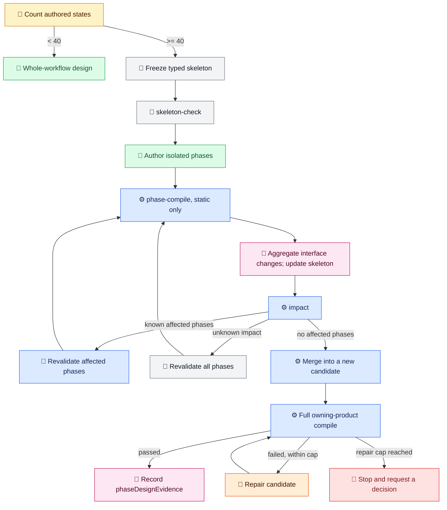

# Workflow Model

[中文](../../zh-cn/architecture/workflow-model.md) | [Root](../README.md)

The shared workflow model is the language-neutral core that both AO and SO can align on at a low level.

For repo-wide explanatory prose such as **weave out**, **weave back**, **strand**, and **seam**, read [Workflow Terminology](workflow-terminology.md). This page keeps the neutral model terms.

## Core Concepts

- `WorkflowInstance`: the persisted state of one execution.
- `StateNode`: a named node that owns ordered transition groups.
- `TransitionGroup`: a set of transitions evaluated together with one concurrency policy.
- `TransitionBase`: the common metadata for executable, waiting, branching, or placeholder steps.
- `WorkflowHistoryEntry`: the append-only event trail for progression, waits, outputs, and failures.
- Governed workflow identity: `taskType` declares business intent, `workflowKind` declares the route family, `caseId` identifies one business case, and `runId` identifies one execution chain.

## Product Interpretation

- SO executes a fully materialized workflow.
- AO may refine the current workflow over time, but still persists explicit nodes, artifacts, and decisions.
- Shared terms do not imply shared top-level behavior.
- For `templateKind: so-governed-target-skill`, the valid combinations are `skill_enhancement` with `so_self_bootstrap` or `target_skill_enhancement`, and a target-specific task type such as `requirement_generation` or `model_generation` with `target_skill_business`. Compile rejects enhancement/business mismatches, enhancement output families, and enhancement subagents inside business workflow for the skills being enhanced.
- Checked-in templates may use a `runId` beginning with `template:`. The first fresh materialization or `ReadyToStart` run replaces that marker with a generated `run-<guid>` value. The same `caseId` and `runId` then remain on the external workflow copy through compile, run, resume, audit, and completion evidence.
- The public SO runtime supports the canonical transition-group values `firstPass`, `whenAnyResponse`, `whenAnyPass`, `whenAllPass`, and `whenExpression`. Legacy wire values `firstSuccess`, `firstResponse`, and `all` require explicit migration; they are not silently upgraded.

## Transition Group Concurrency

The group strategy controls how transitions whose guards pass are executed. `firstPass` evaluates ready transitions sequentially in ascending `priority`, so use it for ordered alternatives or work that depends on earlier results. A `when*` group accepts external steps only, even when only one branch is ready; compile rejects synchronous or internal members. When multiple external transitions are ready, the selected strategy starts them concurrently.

| Wire value | Resolution |
| --- | --- |
| `firstPass` | Try ready transitions in ascending `priority`, stopping after one advances or waits. |
| `whenAnyResponse` | Resolve on the first returned branch, regardless of whether its `passExpression` passes. |
| `whenAnyPass` | Resolve on the first branch whose `passExpression` passes; if all branches finish without a pass, route through `noPassTargetStateId`. |
| `whenAllPass` | Join through `joinTargetStateId` only after every branch passes; a failed branch routes through `noPassTargetStateId`. |
| `whenExpression` | Evaluate the group `passExpression` against completed branches' projected outputs; join when it is true, or route through `noPassTargetStateId` after all branches finish without a match. |

Branch outputs remain isolated until group resolution applies explicit `outputPath` or `outputBindings` projections. Keep concurrent projections disjoint; conflicting paths fail the group without partially merging results. Declare appropriate `noPassTargetStateId`, `errorHandlingTargetStateId`, and `timeoutTargetStateId` routes.

`fanoutCancellationSignals` is runtime-owned: leave it empty in authored instances. Persisted signals record logical cancellation intent and late-result rejection; they do not prove that an external worker was physically stopped.

## Phase-Sliced Workflow Design

Count authored `StateNode`s only; transitions and synthetic harness nodes do not contribute. Workflows below 40 authored states stay on whole-workflow design. At 40 or more, freeze a standalone `loom.workflow-skeleton.v1` before phase authoring. Freeze stable phase IDs and prefixes, entries and exits, typed imports and exports, dependencies, gate and terminal ownership, routes, and backedges. The owning `context_fields` catalog remains the authority for types, nullability, and ownership. Keep each phase at or below 25 authored states as a soft cap and record exceptions.

Use the selected AO apphost for every AO phase command and the selected SO apphost for every SO phase command. These product paths stay independent. `phase-compile` checks static structure, expressions, projections, and interfaces only; it never runs business scripts, HTTP, AskUser, or subagents. Aggregate interface-change requests centrally, update the skeleton, then run `impact`. Impact compares structured workflow, catalog, dependency, and interface facts rather than hashes. Revalidate affected phases and proven dependents; unknown ownership or dependencies require full revalidation.

`merge` accepts exactly one passing result per expected phase and writes a new candidate. Run the complete owning-product compile against that exact candidate; phase checks or merge success alone are not readiness. Never modify or migrate an active `WorkflowInstance`. Limit repair to three attempts per phase and two post-merge full-compile rounds. At either cap, preserve evidence and ask for an explicit decision.

The designer stores detailed `phaseDesignEvidence` inside the existing `static-contract-review.json` and returns a typed `phase_design_evidence` summary linked to that record. Do not create a fourth report. Skeletons, fragments, results, and candidates are external run support.

**Color legend:** pale yellow = routing threshold; light gray = contract or validation; green = authoring; blue = runtime command; rose = evidence; pale orange = repair; pale red = stop or decision boundary. The emoji provide the same categories without relying on color.

## Design Direction

The public model is meant to preserve the useful parts of the reference task-tracking design without carrying private product dependencies into the open-source core.
