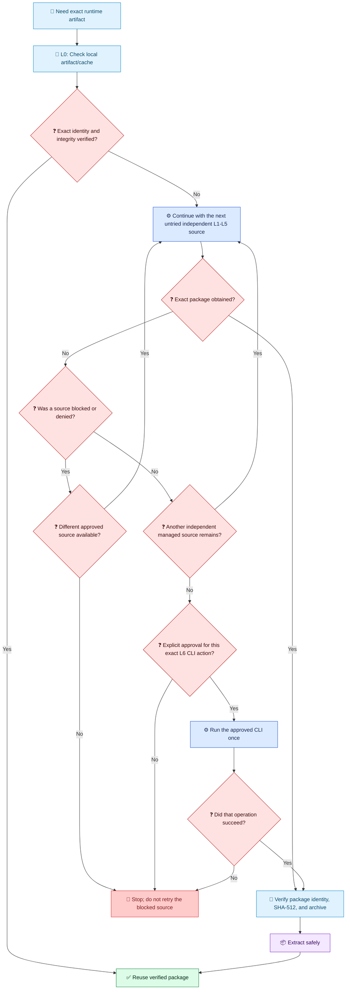
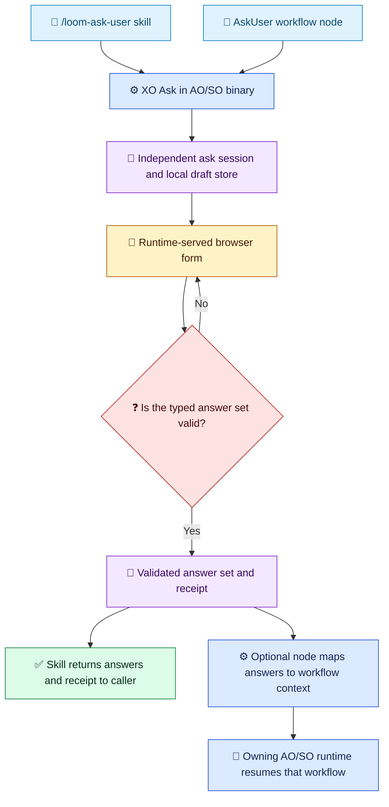

# XO Ask and AskUser Consumers

[简体中文](../../zh-cn/guides/ask-user-guide.md) | [Guides](README.md) | [Design](../architecture/ask-user-design.md)

<!-- guide-version:start -->
Version: 0.4.11-beta
Build: published package 0.4.11-beta
<!-- guide-version:end -->

## Three Layers

`XO Ask` is shorthand for the shared ask capability exposed by either existing AO or SO runtime binary. It is not a third product or package family.

| Layer | Responsibility | Workflow required? |
| --- | --- | --- |
| XO Ask in an AO/SO binary | Shared question contract, browser session, validation, local drafts, and receipt | No |
| `/loom-ask-user` skill | Agent-facing peer consumer: returns session answers and a receipt, or warned unattended answers without a receipt | No |
| `AskUser` workflow node | Workflow-facing peer consumer: declares questions, maps the receipt into workflow context, and lets the owning runtime resume | Yes, only for this adapter |

The skill and node are independent consumers of XO Ask. Neither calls or depends on the other. A standalone ask has its own ask-session identity and local state; it does not create or require a `WorkflowInstance`. Workflow-specific `contextPath`, `requiredInputs`, SO `validation.declaredUserOwnedFields`, projection, and resume belong only to the node adapter.

## Current Release Status

Standalone `ask start --contract-file <path>` and `ask result --ask-id <id>` support is version-specific. Before use, confirm the exact selected published AO or SO apphost's fresh help exposes both commands. The optional `AskUser` workflow node does not establish that the standalone entry point exists. If the selected apphost lacks it, report the exact runtime limitation; do not silently substitute a workflow node or agent-native form.

## Standalone Route

Use `/loom-ask-user` by default for agent-facing structured clarification. Keep the optional `AskUser` workflow node for workflow-owned answers that must be projected into that same workflow instance.

1. Put the caller's independent questions into one ordered, typed form contract. Preserve prompt, context, intent, required state, options, freeform behavior, and relevant constraints.
2. Resolve the exact AO/SO release version from the skill version block and detect the host RID. Follow the acquisition order below. Prefer the exact AO package when both AO and SO are equally suitable and neither is cached.
3. Verify package identity, version, RID, SHA-512, manifest, archive paths, apphost, and a fresh guide. Confirm the selected apphost actually exposes its standalone ask entry.
4. Write the complete contract to a path-only file, then run `ao ask start --contract-file <path>` or `so ask start --contract-file <path>`. Present only the returned host-approved browser route; never infer a public URL or create a tunnel.
5. After one submission, query the matching `ao ask result --ask-id <id>` or `so ask result --ask-id <id>`. Return the typed answers and receipt; do not resume a workflow from the skill.

## Autopilot and Unattended Runs

When the host explicitly identifies an autopilot or unattended run, apply this branch before starting the interactive route or acquiring a runtime. Do not invoke a blocking user-input tool, open a browser, or wait for a person. If any question requires genuine human approval, never submit an agent-generated approval or consume the active session; return warned suggestions and leave the session and any workflow waiting.

- If the same ask session is already running, the runtime returned its endpoint, and the session does not require genuine human approval, submit context-based, type-valid answers through that endpoint's supported HTTP session/submission flow. Use only the returned endpoint, do not start another worker, and keep pairing/session credentials private. The runtime will produce a real receipt, but the answers are still agent-generated and not user-confirmed.
- If there is no usable active endpoint, skip starting the interactive ask and return the best-supported typed answers directly. Mark unknowns only when the contract permits them; otherwise leave them unresolved. No submitted session means no runtime receipt or server validation. Do not claim user confirmation, and clearly warn that the user was unavailable and the answers were generated.
- When writable, preserve the user-absent explanation in caller-provided additional-context, or in the existing question `context` before a session starts. Never mutate an active contract, add wire fields, or disguise this explanation as an answer.
- For a structured workflow `AskUser` node, do not fabricate a receipt or bypass owning-runtime validation. If HTTP submission is unavailable and no declared noninteractive continuation exists, return the generated answers and warning and report that the workflow remains waiting. If genuine human approval is required, do not submit an agent-generated approval via HTTP or consume the active session; provide warned suggestions and leave it pending. A receipt for an agent-generated answer does not establish human approval; if genuine human approval is required, leave the workflow waiting.

Outside autopilot, use the normal host-approved browser handoff. Newer AO/SO runtimes include conditional unattended guidance in the node-entry `skill_hint` alongside the authored hint. AO returns endpoints in `ask_user_endpoints`; SO returns them in the separate `ask_user` envelope's `endpoints`. Older locked runtimes may not emit this guidance, so retain it in the authored hint and skill policy.

## Dependency Acquisition Order

Use the first available, integrity-checked capability for the exact locked AO/SO runtime package. Skip a tier only when its capability is unavailable or its source is unavailable; never install a runtime or downloader solely to acquire the package.

| Tier | Capability | Rule |
| --- | --- | --- |
| L0 | Existing local artifact or cache | Check the shared AO/SO runtime cache, NuGet cache, workspace, configured package cache, and known local paths. Reuse only after exact identity/version/RID and required integrity are verified. |
| L1 | Agent/Host-controlled fetch | Use a controlled fetch for the exact package from its configured primary source; do not start a downloader subprocess. |
| L2 | Existing `nuget.exe` | Reuse only if already installed and executable for the exact NuGet package. Do not install `nuget.exe`, .NET Framework, or a .NET SDK. |
| L3 | Existing runtime's native HTTP API | Use an already-installed runtime's in-process API, such as Node `fetch`, Python `urllib`, or .NET `HttpClient`; do not launch a downloader subprocess or install a runtime. |
| L4 | Known GitHub MCP release asset | Use only a preconfigured, approved repository, exact release tag/asset, and matching `.sha512` sidecar. Skip it if the approved capability is not already exposed; do not register or inspect MCP before the fresh `--guide`. |
| L5 | Other approved Host/MCP source | Use only an already-available, configured source and exact artifact with required integrity evidence. |
| L6 | Generic network CLI | Last resort after L0-L5 are unavailable, with explicit per-operation approval naming the tool, source/host, exact artifact/version, destination, and purpose. |

PowerShell `Invoke-WebRequest`/`Invoke-RestMethod`, `curl`, `gh`, `wget`, BITS tools/cmdlets, and equivalent first- or third-party download CLIs are all L6; being preinstalled or first-party does not exempt them. The only earlier CLI exception is an already-installed `nuget.exe` at L2. A direct in-process .NET `HttpClient` call from PowerShell is L3; PowerShell `Invoke-WebRequest`/`Invoke-RestMethod` remain L6. After any failed request, do not automatically switch transports to repeat the same artifact/source. A nonblocked source may be retried only as an explicit L6 operation after L0-L5 are exhausted and the user approves that exact CLI action. If the source or request is explicitly blocked or denied by network/security policy, stop all attempts to that source through every transport; continue only with an independently configured and approved fallback source, otherwise stop and report the blocker. If the user denies CLI approval, stop and do not switch tools or sources to evade that decision. User approval does not override host security policy and cannot guarantee that an alert will not fire.

Verify every NuGet package against exact registration `catalogEntry.packageHash` (SHA-512), then validate package identity, version, RID, nuspec, `runtime.json`, archive size and safe paths, apphost, and English guide files before extraction. A GitHub package requires an independently configured, approved same-version release asset and matching `.sha512` sidecar.

Legend: 🧭 request intake (blue); 🔎 inspection (blue); ⚙️ managed or approved action (blue); ❓ decision (red); 🚧 blocked (red); 📦 safe extraction (violet); ✅ verified use (green). The labels carry meaning independently of color.

## Shared Browser Flow

The branches below are independent consumers of the same binary capability. A caller chooses one branch; the skill does not route through the node.

Legend: 🧭 consumer (blue); ⚙️ binary or workflow-node action (blue); 💬 user interaction (amber); 🧾 ask state/result (violet); ❓ validation decision (red); 🔁 optional workflow continuation (teal); ✅ direct result (green). Labels and symbols carry meaning independently of color.

## Question and Answer Semantics

Use stable question IDs and ordered groups. Supported types are `singleChoice`, `multipleChoice`, `text`, `number`, `boolean`, `file`, and `audio`. A default only prefills a control; it does not satisfy a required answer. Choice questions provide `Other` as a free-text alternative, so a clarification round can preserve choice suggestions while allowing a user-authored answer. See [answer semantics](../../../.agents/skills/loom-ask-user/reference/answer-semantics.md).

Standalone answers are returned by question ID and do not need workflow context paths. When an `AskUser` node is the consumer, its adapter supplies `contextPath` bindings, checks `requiredInputs` and SO ownership declarations, then maps the receipt and invokes the owning runtime's existing resume. That node-specific contract does not constrain the skill consumer.

## Runtime and Safety

AO and SO remain independent products but publish one exact-version runtime closure. `XO Ask` is only shorthand for the shared capability present in one of those binaries. The skill version block tracks the shared release-set version; it is not a claim that a specific version implements standalone `ask`.

Pairing URLs are secrets. Pass them only through the approved browser handoff; do not repeat them in ordinary progress, logs, or audit summaries. Use only host-approved routes. Do not fetch arbitrary remote attachment URLs.

## Related Pages

- [AskUser design](../architecture/ask-user-design.md)
- [AskUser implementation plan](../architecture/ask-user-implementation-plan.md)
- [Using Techne Loom Skills](skill-usage.md)
- [SkillOrchestrator guide](so-guide.md)
- [Loom Agent Plan-Execution Orchestrator guide](ao-guide.md)
