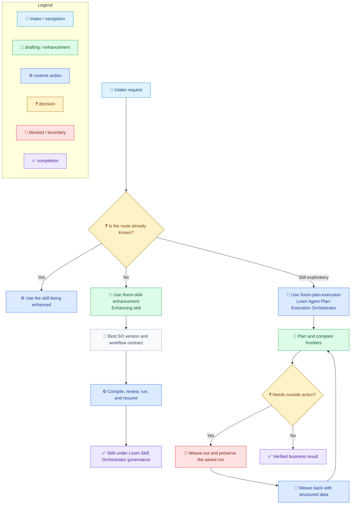
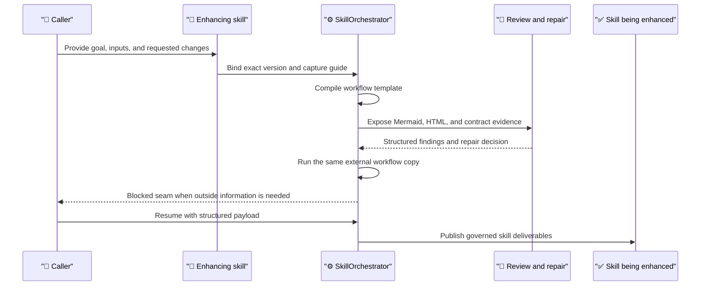

# Using Techne Loom Skills

[中文](../../zh-cn/guides/skill-usage.md) | [Root](../README.md)

This guide is the operator-facing entry for using Techne Loom skills in practice.

## Start With The Right Skill

Choose the entry by uncertainty and risk. The `/loom-skill-enhancement` **enhancing skill** turns a deterministic request into a skill under Loom Skill Orchestrator governance. `/loom-plan-execution` uses the **Loom Agent Plan-Execution Orchestrator** while the route is still exploratory.

| Need | Start with |
| --- | --- |
| Share concise instructions with an existing host | Agent Skills: `SKILL.md`, `AGENTS.md`, or the host's native plugin surface |
| Create or upgrade a deterministic skill | `/loom-skill-enhancement` (enhancing skill) |
| Use a skill that already has a governed workflow | The skill being enhanced, now under Loom Skill Orchestrator governance |
| Prefer one shared AskUser form by default for agent-facing structured questions and decisions, without a workflow dependency | `/loom-ask-user` |
| Explore an uncertain route before it becomes deterministic | `/loom-plan-execution` and Loom Agent Plan-Execution Orchestrator |



The diagram uses emoji and labels as the meaning channel. Colors reinforce the categories but are never the only signal.

## Choose The Right Entry

| Situation | Use this | Read first | Official run surface |
| --- | --- | --- | --- |
| The route is still unclear | `/loom-plan-execution` | `packages.released.md` or `packages.beta.md`, then the guide from the exact AO package | `ao.exe run` / `ao.exe resume` on Windows; `ao run` / `ao resume` on Unix |
| You want to create or upgrade a deterministic skill | `/loom-skill-enhancement` | the matching SO package index, then the guide from the exact SO package | after enhancement, `so.exe run` / `so.exe resume` on Windows; `so run` / `so resume` on Unix; `compile` is validation only |
| Collect agent questions across agents in one form (the default route) | `/loom-ask-user` | [XO Ask guide](ask-user-guide.md) | One ordered submission through an exact AO/SO binary; no workflow required. |
| The skill already has a governed workflow | the skill being enhanced | its `SKILL.md` and `assets/so-workflow/so-package-lock.json` | `so.exe run` / `so.exe resume` on Windows or `so run` / `so resume` on Unix, against an external workflow copy |

## Reading Large JSON

For JSON larger than 16 KiB (16,384 UTF-8 bytes), inspect only what the task needs by default:

- Use search or regex to locate the target key or path, then read a bounded line window and expand only as needed.
- For minified JSON or unsafe line slices, use JSON Pointer or a structured parser to extract the needed subtree.
- Read the full document only when the user asks for it or whole-document validation requires it.
- This policy applies to JSON data; `.agent.md` role contracts still require a full read.

## XO Ask Consumer Boundaries

`XO Ask` is the shared ask capability in either AO or SO runtime binary. It is not a third product. `/loom-ask-user` and the `AskUser` workflow node are independent peer consumers:

| Consumer | Role | Workflow required? |
| --- | --- | --- |
| `/loom-ask-user` | Shapes agent questions, starts a standalone session, and returns answers plus receipt | No |
| `AskUser` node | Maps its result to workflow context and delegates resume to its owning runtime | Yes, for the node adapter only |

The skill and node do not call or depend on each other. Use `/loom-ask-user` by default for agent-facing structured questions. Reserve an `AskUser` node for a workflow-owned user value that must be projected into that same `WorkflowInstance`; runtime-owned facts and artifact paths stay on runtime-owned boundaries.

## Dependency Acquisition Policy

Every skill uses the shared acquisition order: L0 existing local artifacts/cache; L1 Agent/Host-controlled fetch; L2 already-installed `nuget.exe` for an exact NuGet package; L3 an existing runtime's in-process HTTP API; L4 a known, approved GitHub Release MCP asset; L5 another approved Host/MCP source; and L6 a generic network CLI only after L0-L5 are unavailable and the user explicitly approves that exact operation.

PowerShell `Invoke-WebRequest`/`Invoke-RestMethod`, `curl`, `gh`, `wget`, BITS tools/cmdlets, and equivalent first- or third-party download CLIs are all L6. Do not install a runtime or downloader solely to acquire a dependency. After a failed request, do not automatically switch transports to repeat the same artifact/source; if a source is blocked or denied, stop all access to it through every transport and continue only with an independently configured and approved source. User approval does not override host security policy or guarantee that an alert will not fire.

For development-support references, hashes may be generated as optional metadata, but consumers must not calculate, compare, re-attest, freshness-check, or gate on them. Exact package SHA-512 verification and every artifact hash required by the target business contract remain mandatory. See the [XO Ask guide](ask-user-guide.md) for the detailed ladder and flow.

## Workflow Runtime Setup Rules

The following setup steps apply to AO/SO workflow-running skills and the optional `AskUser` node adapter. They are not prerequisites for standalone XO Ask.

1. Run [Platform Detection Steps](../reference/runtime/platform-detection.md) before runtime acquisition.
2. Bind one exact product/RID package from the lock. Verify its package hash and use that same apphost for `--guide`, `compile`, `run`, and `resume`.
3. Use a fresh `--guide` result before planning or editing skill deliverables.
4. Keep runtime copies, audit output, event sidecars, and compile artifacts outside skill directories.
5. Treat `compile` as preparation or validation. Only `run` and `resume` are official workflow execution.

## `/loom-plan-execution`

Use this entry when the route needs exploration, clarification, frontier comparison, or a structured handoff before deterministic work begins.

### Inputs

- a rich plan with at least 10 non-empty lines, or a detailed plan file path
- the requested language
- an optional audit output root

### Official Run

```powershell
.\ao.exe --guide
.\ao.exe compile --workflow-file <external-workflow.json> --audit-output <external-audit-root>
.\ao.exe run --workflow-file <external-workflow.json>
.\ao.exe resume --workflow-file <external-workflow.json> --result-file <result.json>
# On Unix, use the `ao` apphost instead.
```

`--guide`, `compile`, `prompt-plan`, and `prompt-replan` support preparation or recovery. Only `run` and `resume` count as official AO runs.

## `/loom-skill-enhancement`

Use this **enhancing skill** to create or upgrade the **skill being enhanced**.

### Inputs

- the skill being enhanced path or repository path
- a deterministic goal or upgrade request
- requested skill changes
- the exact SO version from its lock and version block
- an optional context file and audit output root

### Governed Route



The official success path must continue through direct `so.exe run` and `so.exe resume` on Windows, or `so run` and `so resume` on Unix, until final completion evidence exists.

### If a Named Agent Is Unavailable

Follow the [Named Agent Resolution rule](../../../.agents/skills/loom-skill-enhancement/SKILL.md#named-agent-resolution) and [Subagent Authority Rules](../../../.github/instructions/loom-skill-governance.instructions.md#subagent-authority-rules); `/loom-plan-execution` uses the same [Named Agent Resolution rule](../../../.agents/skills/loom-plan-execution/SKILL.md#named-agent-resolution). Host registration only decides how a role is dispatched; it never replaces or invalidates the named `.agent.md` contract. Before dispatch, compare the exact frontmatter `name` with the host's registered agent list. Skill-local `assets/agents/` files are usually not registered, so treat a missing name, `agent not found`, an unknown agent, a subagent tool with no `agentName` parameter, or a silent default-agent response as not registered and switch to the driver route in the same step. The driver is an available general-purpose agent that can edit and validate, never a read-only agent or a similar role. Give it the exact name, a link to the file, and either the full file contents (inline) or a path-only reference without a hash that it must read in full and confirm by echoing the frontmatter name; pass the reference manifest, runtime inputs, and expected output contract, large ones by path. A 408, request-size error, or timeout is a transport failure, not a missing agent; retry once path-only. Driver fallback does not require user approval. Stop only if the file is missing or ambiguous, or no driver can do the required design, review, repair, or validation work; then report the blocker and do not claim the handoff succeeded or advance dependent work. Doing the role's work directly without any subagent driver requires explicit user approval.

### Enhancing Skill Agent Contracts

Each link opens the full checked-in `.agent.md` contract. Use the listed `assets/agents/` path relative to the active `/loom-skill-enhancement` skill root when dispatching; pass the complete file contents and required inputs to the agent or generic driver.

| Agent contract | Skill-relative call path | Responsibility |
| --- | --- | --- |
| [loom-skill-enhancement-workflow-designer.agent.md](../../../.agents/skills/loom-skill-enhancement/assets/agents/loom-skill-enhancement-workflow-designer.agent.md) | `assets/agents/loom-skill-enhancement-workflow-designer.agent.md` | Design or revise the governed workflow graph. |
| [loom-skill-enhancement-mcp-startup.agent.md](../../../.agents/skills/loom-skill-enhancement/assets/agents/loom-skill-enhancement-mcp-startup.agent.md) | `assets/agents/loom-skill-enhancement-mcp-startup.agent.md` | Configure optional MCP only after guide capture. |
| [loom-skill-enhancement-scope-input-output-analysis.agent.md](../../../.agents/skills/loom-skill-enhancement/assets/agents/loom-skill-enhancement-scope-input-output-analysis.agent.md) | `assets/agents/loom-skill-enhancement-scope-input-output-analysis.agent.md` | Analyze scope, inputs, outputs, and business deliverables. |
| [loom-skill-enhancement-route-gate-analysis.agent.md](../../../.agents/skills/loom-skill-enhancement/assets/agents/loom-skill-enhancement-route-gate-analysis.agent.md) | `assets/agents/loom-skill-enhancement-route-gate-analysis.agent.md` | Analyze branches, loops, ownership joins, and required checks. |
| [loom-skill-enhancement-evidence-node-map-analysis.agent.md](../../../.agents/skills/loom-skill-enhancement/assets/agents/loom-skill-enhancement-evidence-node-map-analysis.agent.md) | `assets/agents/loom-skill-enhancement-evidence-node-map-analysis.agent.md` | Map workflow nodes to deliverables and evidence. |
| [loom-skill-enhancement-reenhancement-conflict-judgment.agent.md](../../../.agents/skills/loom-skill-enhancement/assets/agents/loom-skill-enhancement-reenhancement-conflict-judgment.agent.md) | `assets/agents/loom-skill-enhancement-reenhancement-conflict-judgment.agent.md` | Choose patch, refactor, or template regeneration for re-enhancement. |
| [loom-skill-enhancement-skill-markdown-gap-review.agent.md](../../../.agents/skills/loom-skill-enhancement/assets/agents/loom-skill-enhancement-skill-markdown-gap-review.agent.md) | `assets/agents/loom-skill-enhancement-skill-markdown-gap-review.agent.md` | Review SKILL.md governance wording against the current guide. |
| [loom-skill-enhancement-package-lock-gap-review.agent.md](../../../.agents/skills/loom-skill-enhancement/assets/agents/loom-skill-enhancement-package-lock-gap-review.agent.md) | `assets/agents/loom-skill-enhancement-package-lock-gap-review.agent.md` | Review the exact SO package lock against the guide and bound version. |
| [loom-skill-enhancement-workflow-governance-gap-review.agent.md](../../../.agents/skills/loom-skill-enhancement/assets/agents/loom-skill-enhancement-workflow-governance-gap-review.agent.md) | `assets/agents/loom-skill-enhancement-workflow-governance-gap-review.agent.md` | Review workflow governance assets against the current guide. |
| [loom-skill-enhancement-weave-out-subagent-fit-review.agent.md](../../../.agents/skills/loom-skill-enhancement/assets/agents/loom-skill-enhancement-weave-out-subagent-fit-review.agent.md) | `assets/agents/loom-skill-enhancement-weave-out-subagent-fit-review.agent.md` | Decide whether a handoff needs its own local agent contract. |
| [loom-skill-enhancement-review-findings-aggregator.agent.md](../../../.agents/skills/loom-skill-enhancement/assets/agents/loom-skill-enhancement-review-findings-aggregator.agent.md) | `assets/agents/loom-skill-enhancement-review-findings-aggregator.agent.md` | Aggregate parallel findings without performing repairs. |
| [loom-skill-enhancement-review-fix-loop.agent.md](../../../.agents/skills/loom-skill-enhancement/assets/agents/loom-skill-enhancement-review-fix-loop.agent.md) | `assets/agents/loom-skill-enhancement-review-fix-loop.agent.md` | Coordinate accepted repairs and post-fix readiness evidence. |

### Example

```text
/loom-skill-enhancement
Language: en
Skill being enhanced: {agentskillfolder}/my-skill
Goal: upgrade this deterministic skill under Loom Skill Orchestrator governance
Requested skill changes:
- refresh SKILL.md governance wording
- create the runtime-owned plan under <execution-output-root>/plan/skill-plan.md
- create or refresh assets/so-workflow/so-template.json
- align assets/so-workflow/so-package-lock.json
```

## Continue Reading

- [Loom Agent Plan-Execution Orchestrator Guide](ao-guide.md)
- [SkillOrchestrator Guide](so-guide.md)
- [Loom Skill Enhancement Call Examples](../examples/skill-enhancement-calls.md)
- [Structured AskUser Guide](ask-user-guide.md)
- [Workflow Terminology](../architecture/workflow-terminology.md)
- [Skill Under Loom Skill Orchestrator Governance Run Example](../examples/so-enhanced-skill-run.md)
