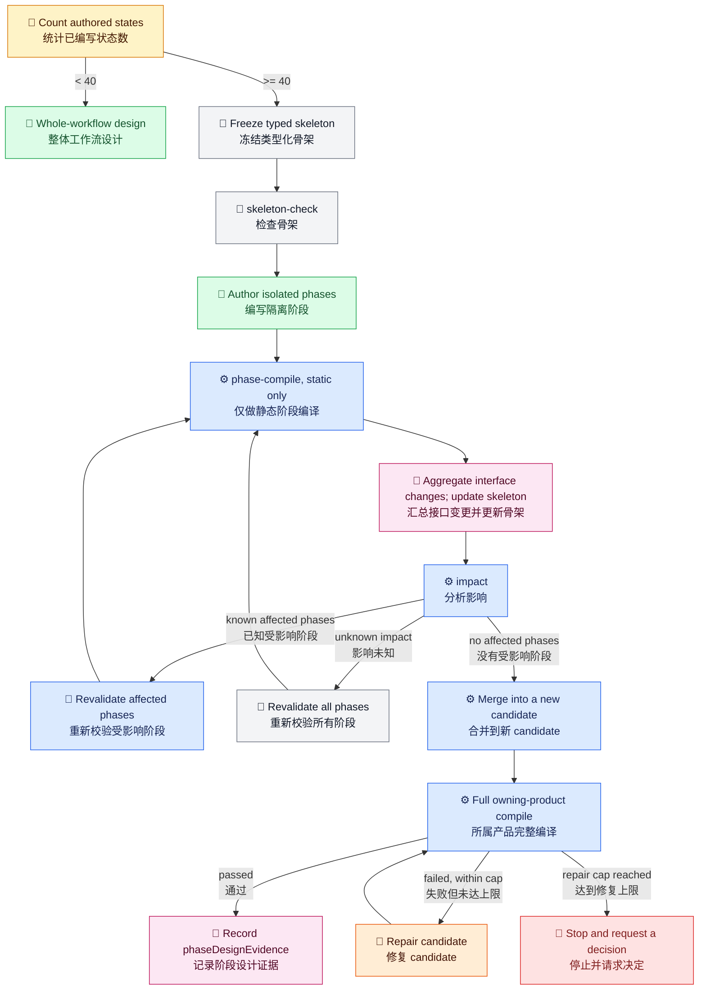

# Workflow 模型

[English](../../en/architecture/workflow-model.md) | [根目录](../README.md)

共享 workflow 模型是语言中立的核心，AO 与 SO 可以在低层围绕它达成一致。

涉及 **weave out**、**weave back**、**strand**、**seam** 这类 repo 级解释性术语时，请先阅读 [Workflow 术语](workflow-terminology.md)。这一页保留的是中性的模型名词。

## 核心概念

- `WorkflowInstance`：一次执行的持久化状态。
- 受治理 workflow 的身份：`taskType` 声明业务意图，`workflowKind` 声明路线类型，`caseId` 标识一个业务案例，`runId` 标识一条执行链。
- `StateNode`：拥有有序 transition group 的命名节点。
- `TransitionGroup`：按一种并发策略一起评估的一组 transition。
- `TransitionBase`：可执行、等待、分支或占位步骤的公共元数据。
- `WorkflowHistoryEntry`：记录推进、等待、输出与失败的追加式事件轨迹。

## 产品视角

- SO 执行的是完整物化后的 workflow。
- AO 允许逐步重写当前 workflow，但仍需持久化节点、产物与决策。
- 共享术语不代表共享顶层行为。
- 当前公开 SO runtime 支持 canonical transition-group wire values：`firstPass`、`whenAnyResponse`、`whenAnyPass`、`whenAllPass` 与 `whenExpression`。旧 wire values `firstSuccess`、`firstResponse` 和 `all` 需要显式迁移；runtime 不会静默升级。
- 对于 `templateKind: so-governed-target-skill`，合法组合是 `skill_enhancement` 配合 `so_self_bootstrap` 或 `target_skill_enhancement`，以及 target-specific task type（例如 `requirement_generation` 或 `model_generation`）配合 `target_skill_business`。compile 会拒绝 enhancement/business 错配，也会拒绝 business workflow for the skill being enhanced 携带 enhancement output family 或 enhancement subagent。
- checked-in template 可以把 `runId` 写成以 `template:` 开头的标记。第一次物化或对 `ReadyToStart` 副本执行 `run` 时，该标记会被替换成生成的 `run-<guid>`；之后同一个外部 workflow copy 在 compile、run、resume、audit 和 completion evidence 中都保留同一组 `caseId` 与 `runId`。

## Transition Group 并发策略

策略决定 guard 满足的 transitions 如何执行。`firstPass` 按 `priority` 升序顺序尝试，适用于有序备选项或依赖前一步结果的工作。`when*` group 只能包含外部步骤，即使当前只有一个分支 guard 通过也一样；compile 会拒绝同步或内部步骤。多个外部 transition 同时 ready 时，所选策略会并发启动它们。

| wire value | 处理方式 |
| --- | --- |
| `firstPass` | 按 `priority` 升序尝试 ready transitions；某个 transition 推进或等待后停止。 |
| `whenAnyResponse` | 选择第一个返回的分支，不以该分支的 `passExpression` 是否通过作为筛选条件。 |
| `whenAnyPass` | 选择第一个 `passExpression` 通过的分支；全部分支结束仍无通过项时，转到 `noPassTargetStateId`。 |
| `whenAllPass` | 仅当所有分支都通过后才进入 `joinTargetStateId`；任一分支失败时转到 `noPassTargetStateId`。 |
| `whenExpression` | 对已完成分支的显式投影结果评估 group `passExpression`；条件为真时进入 join，所有分支结束仍不匹配时转到 `noPassTargetStateId`。 |

分支输出在 group 结果确定前保持隔离，之后只按显式的 `outputPath` 或 `outputBindings` 投影。并发分支的投影路径应互不重叠；发生冲突时整个 group 失败，不会留下部分合并结果。应按需声明 `noPassTargetStateId`、`errorHandlingTargetStateId` 与 `timeoutTargetStateId` 路由。

`fanoutCancellationSignals` 由 runtime 管理，作者应在 workflow 中留空。持久化信号表示已提出逻辑取消并会忽略迟到结果；它不代表外部执行器已被物理停止。

## 分阶段 Workflow 设计

只统计已编写的 `StateNode`；transition 和合成 harness 节点不计入数量。少于 40 个已编写状态的 workflow 保持整体设计。达到 40 个时，先冻结独立的 `loom.workflow-skeleton.v1`，再编写各阶段。骨架需冻结稳定的阶段 ID 与前缀、入口和出口、类型化导入与导出、依赖关系、gate 与 terminal 的归属、跨阶段路由及 backedge。类型、可空性和所有权以所属 contract 的 `context_fields` 为唯一依据。每个阶段以 25 个已编写状态为软上限；超出时记录原因。

AO 的所有阶段命令使用同一个已选 AO apphost，SO 的所有阶段命令使用同一个已选 SO apphost。两个产品保持独立。`phase-compile` 只检查静态结构、表达式、投影和阶段接口，不运行业务脚本、HTTP、AskUser 或 subagent。集中汇总接口变更请求并更新骨架，然后运行 `impact`。Impact 比较工作流、catalog、依赖和接口的结构化定义，不比较哈希。只重新校验受影响阶段及已证明的依赖项；所有权或依赖关系未知时，必须完整重新校验。

`merge` 要求每个预期阶段恰好有一个通过的结果，并写入新的 candidate。随后使用所属产品的同一个 apphost，对这个 candidate 执行完整 compile；阶段检查或 merge 成功本身不代表已就绪。不得修改或迁移正在运行的 `WorkflowInstance`。每阶段最多修复三次，合并后完整 compile 最多修复两轮。达到任一上限时，保留证据并请求明确决定。

Designer 将详细的 `phaseDesignEvidence` 保存在现有 `static-contract-review.json`，并返回链接到该记录的类型化 `phase_design_evidence` 摘要。不要新增第四份报告。骨架、阶段片段、阶段结果和 candidate 都是本次运行的外部辅助文件。

**颜色图例：** 浅黄色 = 路由阈值；浅灰色 = 合同或校验；绿色 = 编写；蓝色 = runtime 命令；玫红色 = 证据；浅橙色 = 修复；浅红色 = 停止或决策边界。emoji 表达相同类别，因此含义不依赖颜色。

## 设计方向

公开模型旨在保留参考 task-tracking 设计中有价值的部分，同时不把私有产品依赖带进开源核心。
