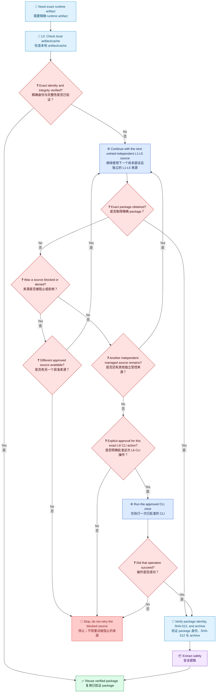
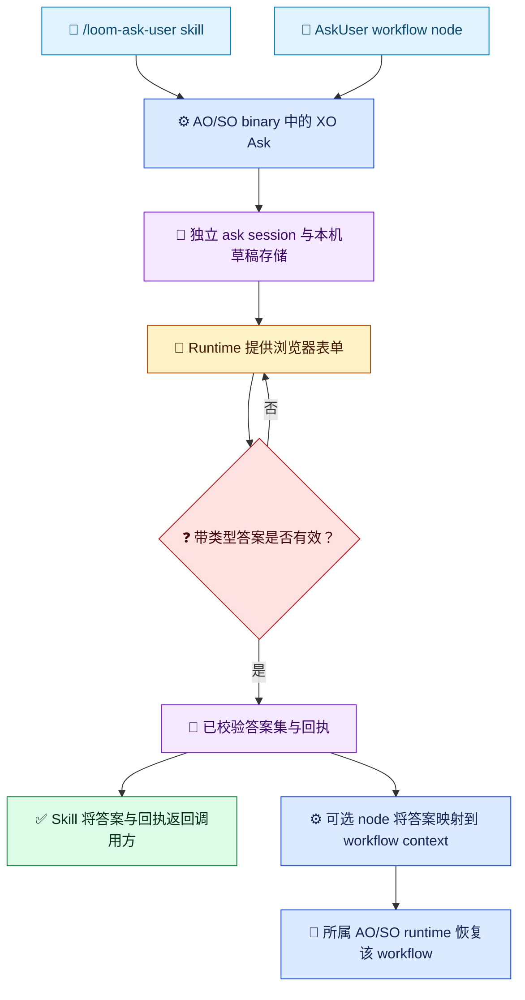

# XO Ask 与 AskUser 消费方

[English](../../en/guides/ask-user-guide.md) | [指南索引](README.md) | [设计](../architecture/ask-user-design.md)

<!-- guide-version:start -->
版本：0.4.11-beta
构建：已发布的 0.4.11-beta 包
<!-- guide-version:end -->

## 三层关系

`XO Ask` 是对现有 AO 或 SO runtime binary 所提供共享 ask 能力的简称；它不是第三个产品，也不是新的 package 家族。

| 层 | 职责 | 是否需要 workflow？ |
| --- | --- | --- |
| AO/SO binary 中的 XO Ask | 共享问题契约、浏览器会话、答案校验、本机草稿和回执 | 不需要 |
| `/loom-ask-user` skill | 面向 agent 的并列消费者：返回会话答案与回执，或返回带警告且无回执的无人值守答案 | 不需要 |
| `AskUser` workflow node | 面向 workflow 的并列消费者：声明问题、把回执映射到 workflow context，并由所属 runtime 恢复执行 | 仅这个适配路径需要 |

Skill 和 node 是 XO Ask 的两个独立消费者，彼此不调用、不依赖。Standalone ask 有自己的 ask-session 身份和本机状态，不创建也不要求 `WorkflowInstance`。`contextPath`、`requiredInputs`、SO 的 `validation.declaredUserOwnedFields`、答案投影和 resume 都只属于 node 适配器。

## 当前发布状态

Standalone `ask start --contract-file <path>` 与 `ask result --ask-id <id>` 的支持取决于 runtime 版本。使用前必须检查精确所选的已发布 AO 或 SO apphost 的 fresh help，确认两个命令都存在。可选的 `AskUser` workflow node 不能证明 standalone 入口存在。若所选 apphost 缺少入口，应报告准确的 runtime 能力限制；不要悄悄改用 workflow node 或 agent 内置提问工具。

## 独立入口

面向 agent 的结构化澄清默认使用 `/loom-ask-user`。只有当 workflow 自己拥有用户答案，并且必须把答案映射回同一个 workflow instance 时，才使用可选的 `AskUser` workflow node。

1. 将调用方彼此独立的问题整理成有序、带类型的表单契约，保留 prompt、context、intent、必填状态、选项、自由填写和适用约束。
2. 从 skill 版本块解析 AO/SO release-set 的精确版本并检测 host RID。遵循下方的获取顺序；如果 AO 和 SO 都适用且都没有缓存，优先使用精确 AO package。
3. 校验 package 身份、版本、RID、SHA-512、manifest、archive 路径、apphost 和 fresh guide，并确认所选 apphost 确实提供 standalone ask 入口。
4. 先将完整契约写入磁盘文件，再调用 `ao ask start --contract-file <path>` 或 `so ask start --contract-file <path>`。只呈现返回的 host 批准浏览器路由；不要推断公网 URL，也不要创建 tunnel。
5. 用户一次提交后，使用对应的 `ao ask result --ask-id <id>` 或 `so ask result --ask-id <id>` 查询结果。将带类型答案与回执返回调用方；skill 不恢复 workflow。

## 自动驾驶与无人值守运行

当 host 明确表示当前运行处于 autopilot 或无人值守模式时，应在启动交互流程或获取 runtime 之前先执行这一分支。不要调用会阻塞的用户输入工具、打开浏览器或等待用户。如果任何问题要求真正的用户批准，不要提交 agent 生成的批准或消耗当前会话；仅返回带警告的建议，保持会话及相关 workflow 等待。

- 如果同一个 ask session 已经运行、runtime 返回了它的 endpoint，且该会话不要求真正的用户批准，就通过该 endpoint 支持的 HTTP session/submission 流程提交依据现有上下文生成且符合类型约束的答案。只使用 runtime 返回的 endpoint，不要启动第二个 worker，也不要猜测路由；pairing URL 和 session token 必须保密。Runtime 会生成真实回执，但答案仍由 agent 生成，未经用户确认。
- 如果没有可用的活动 endpoint，就不要启动交互式提问，直接返回现有上下文最能支持的带类型答案。只有契约允许时才能标记未知，否则保留为未解决。没有提交会话就没有 runtime 回执或服务端校验；不要声称用户已确认，并明确警告用户当前不在场、答案由 agent 生成。
- 如有可写字段，将用户不在场的说明保存在调用方提供的 additional-context 中，或在会话启动前写入问题已有的 `context`。不要修改活动会话的契约、添加 wire 字段，也不要把这段说明伪装成答案。
- 对结构化 workflow `AskUser` node，不要伪造回执或绕过所属 runtime 的校验。如果 HTTP 提交不可用且 workflow 没有声明非交互式继续路径，就返回生成的答案和警告，并说明 workflow 仍在等待。如果需要真正的用户批准，不要通过 HTTP 提交 agent 生成的批准，也不要消耗当前会话；仅提供带警告的建议并保持会话等待。Agent 生成答案的回执不代表用户批准；如果必须获得真正的用户批准，workflow 必须继续等待。

非 autopilot 模式继续使用正常且经 host 批准的浏览器交接。较新的 AO/SO runtime 会在 node 进入时的 `skill_hint` 中保留作者提示并补充无人值守条件说明。AO 在 `ask_user_endpoints` 返回地址；SO 在单独的 `ask_user` 消息的 `endpoints` 中返回地址。较旧的锁定 runtime 可能不提供该说明，因此仍应在作者提示和 skill 策略中保留它。

## 依赖获取优先顺序

只为精确锁定的 AO/SO runtime package 使用第一个可用且完整性校验通过的能力。只有能力不存在或来源不可用时才跳过对应层；不得为获取 package 而安装 runtime 或 downloader。

| 层级 | 能力 | 规则 |
| --- | --- | --- |
| L0 | 已有本地 artifact 或 cache | 检查共享 AO/SO runtime cache、NuGet cache、workspace、已配置 package cache 和已知本地路径；只有精确身份/版本/RID 与所需完整性验证通过才复用。 |
| L1 | Agent/Host 受控 fetch | 从已配置的主来源获取精确 package；不得启动 downloader 子进程。 |
| L2 | 已安装的 `nuget.exe` | 仅当它已经安装且可执行时用于精确 NuGet package。不得安装 `nuget.exe`、.NET Framework 或 .NET SDK。 |
| L3 | 已有 runtime 的原生 HTTP API | 使用已安装 runtime 的进程内 API，例如 Node `fetch`、Python `urllib` 或 .NET `HttpClient`；不得启动 downloader 子进程，也不得安装 runtime。 |
| L4 | 已知 GitHub MCP release asset | 仅使用预先配置并批准的 repository、精确 release tag/asset 和匹配的 `.sha512` sidecar。若能力并未预先提供则跳过；fresh `--guide` 前不得注册或探测 MCP。 |
| L5 | 其他已批准 Host/MCP 来源 | 仅使用已存在、已配置的来源与精确 artifact，并取得所需完整性证据。 |
| L6 | 通用 network CLI | 仅在 L0-L5 都不可用后作为最后方案；必须针对单次操作明确批准 tool、source/host、精确 artifact/version、destination 和 purpose。 |

PowerShell `Invoke-WebRequest`/`Invoke-RestMethod`、`curl`、`gh`、`wget`、BITS tools/cmdlets 以及同类第一方或第三方下载 CLI 都属于 L6；预装或第一方身份不构成豁免。唯一更早的 CLI 例外是 L2 的既有 `nuget.exe`。PowerShell 中直接在进程内调用 .NET `HttpClient` 属于 L3；PowerShell web cmdlets 仍属于 L6。请求失败后，不要自动切换传输方式重试同一个 artifact/source。未被安全策略阻止的来源，只有在 L0-L5 已用尽并且用户明确批准这次精确的 L6 CLI 操作后，才可重试。来源或请求被网络/安全策略明确阻止或拒绝后，必须停止通过所有传输方式访问该来源；只有在存在另一个独立配置并获准的来源时才可继续。用户批准不能覆盖 host 安全策略，也不能保证安全告警不会触发。

每个 NuGet package 都必须与精确 registration `catalogEntry.packageHash`（SHA-512）匹配，并在提取前验证 package 身份、版本、RID、nuspec、`runtime.json`、archive 大小和安全路径、apphost 与英文 guide。GitHub package 必须来自独立配置并获准的同版本 release asset，且有匹配的 `.sha512` sidecar。

图例：🧭 请求接入（蓝）；🔎 检查（蓝）；⚙️ 受控或获准的操作（蓝）；❓ 决策（红）；🚧 阻塞（红）；📦 安全提取（紫）；✅ 验证后使用（绿）。标签和 emoji 一起表达含义，颜色不是唯一线索。

## 共享浏览器流程

下图中的两个分支是同一二进制能力的独立消费者。每次调用只选择其中一个；skill 不经过 workflow node。

图例：🧭 消费方（蓝）；⚙️ binary 或 workflow-node 操作（蓝）；💬 用户交互（琥珀）；🧾 ask 状态/结果（紫）；❓ 校验决策（红）；🔁 可选 workflow 继续执行（青绿）；✅ 直接返回结果（绿）。标签和符号都表达含义，不只依赖颜色。

## 问题与答案语义

使用稳定问题 ID 和有序问题组。支持 `singleChoice`、`multipleChoice`、`text`、`number`、`boolean`、`file` 和 `audio`。默认值只预填控件，不会满足必填条件。选择题以 `Other` 提供自由文本替代项，因此澄清题既能给出推荐选项，也能保留用户自定义答案。详见[答案语义](../../../.agents/skills/loom-ask-user/reference/answer-semantics.md)。

Standalone 答案按问题 ID 返回，不需要 workflow context 路径。只有 `AskUser` node 作为消费者时，才由其适配器提供 `contextPath` binding、检查 `requiredInputs` 与 SO ownership 声明，再映射回执并调用所属 runtime 的现有 resume。这个 node 专属契约不约束 skill 消费方。

## Runtime 与安全

AO 和 SO 是彼此独立的产品，但共同发布同版本 runtime package 闭包。`XO Ask` 只是该共享能力的简称。Skill 版本块记录 release-set 精确版本，不表示指定版本一定已实现 standalone `ask`。

Pairing URL 是秘密，只能经批准的浏览器交接传递；不得写入普通进度消息、日志或审计摘要。只使用 host 批准的路由，不获取任意远程附件 URL。

## 相关页面

- [AskUser 设计](../architecture/ask-user-design.md)
- [AskUser 实施计划](../architecture/ask-user-implementation-plan.md)
- [使用 Techne Loom Skills](skill-usage.md)
- [SkillOrchestrator 指南](so-guide.md)
- [Loom Agent Plan-Execution Orchestrator 指南](ao-guide.md)
