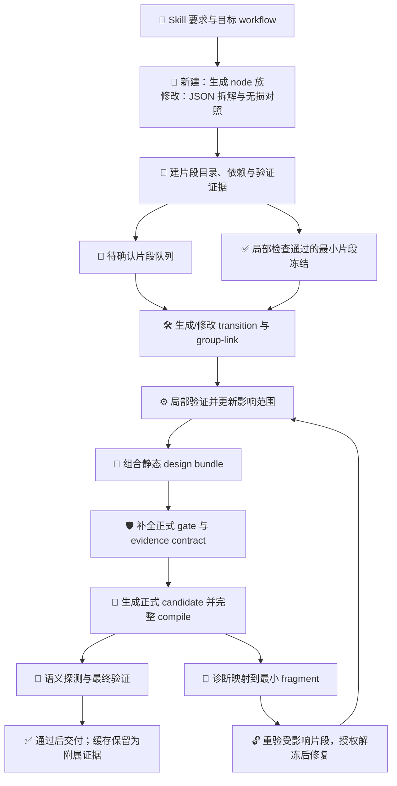

# Workflow 渐进式设计与细粒度冻结改造计划

> 状态：提案，尚未实现。本文记录一次连续 workflow 修改的设计目标、实现阶段、验证边界和验收条件；不是运行时契约，也不授权直接修改或执行任何现有业务 workflow。
>
> 范围：统一 `loom` apphost 下的 AO 与 SO workflow authoring/compile 路径。AO/SO 仍是独立实现模块；共用 Abstractions 合同或 Common 基础设施时，不合并其编译和运行职责。

## 1. 问题与目标

现有生成/修改方式让模型一次返回完整 `Build(WorkflowScriptInput)` 或 `Edit(WorkflowInstance, WorkflowScriptInput)` 脚本。一次小改也可能重读大段上下文、重写大脚本并再次全量编译。更重要的是，当前可复用的 phase 级分解比用户期望的冻结单位粗：错误修一处，已确认设计也容易被重新生成或失去清楚的验证关联。

本改造的目标是让一次连续的“修改 session × 一个 workflow”成为稳定工作单位：从要求或现有 workflow JSON 得到结构化片段目录；以最小且有明确语义的单元生成、验证、确认、冻结、解冻和复用；每次修改依照同一份 session 分解缓存更新状态；只重新生成/检查被本次改动及其依赖影响的单元；由 Loom 生成组合脚本和候选 workflow；最终仍通过当前 owning runtime 的完整 compile 和所需语义验证。

成功标准不是单纯把 C# 文件切小，而是已确认内容不会无故被改写，局部失败能映射回稳定片段 ID，缓存能够证明它针对什么输入和验证条件有效，组合结果与唯一 canonical `WorkflowInstance` 一致，并且最终业务 gate 不能因设计阶段的临时放行而被绕过。

## 2. 当前实现基线与差距

可行性结论：可以先验证单条 owning route 的闭环，当前证据支持开工做技术验证。公开 CLI、双模块接入、字段级拆分和增量性能收益仍需各自通过进入条件。基线为目标分支提交 [`3b81689`](https://github.com/waynebaby/Techne-Loom/tree/3b816892ae3ff1689f29946db806f4e1baddc520)。以下是需要实测的具体接口边界：

- `WorkflowJsonSerializer` 会省略 null，且未配置未知成员保留。导入需在 typed deserialize **之前**记录原始属性、重复键与显式声明，再做往返对照。构建脚本骨架无法证明导入可逆。
- `WorkflowInstance` 同时含设计字段和运行状态；`ReadyToStart` 是类型默认值。导入资格必须结合来源和运行标记检查。
- `StateNode.Groups` 是有序列表，验证 gate 和 route 以字典键标识。group/link 和 route/evidence 之间必须先规定各字段的唯一写入归属，派生引用可索引。

以下是方案依据的当前代码行为，实施前仍须用实际被选中的同版本 apphost 和契约文件复核：

- `Techne.Loom.Common/TaskTracking/Runtime/WorkflowScriptHost.cs` 的入口分别执行一个脚本文件中的 `Build`、`Edit` 或 `Verify`；读取单一文本、构造单一语法树并以一个 Roslyn compilation 编译。
- AO/SO 的 `prompt-plan` / `prompt-replan` 约定模型返回完整 C# builder/editor 脚本；apphost 执行脚本并序列化结果为 canonical JSON。不可改成模型直接手写 JSON、脚本 I/O 或绕过 owning route。
- `WorkflowJsonToCSharpBuilderExporter.GenerateEditScript` 当前只提供一个编辑器起始骨架，不负责把已有 workflow 分解成节点/transition/gate 片段。
- 已有 `WorkflowPhaseSkeleton`、`WorkflowPhaseFragment`、`WorkflowPhaseCompiler`、`WorkflowPhaseMerger` 和 impact analyzer 能做 phase 粒度静态编译、接口检查、影响分析和组合。它是按业务阶段拆分；片段内包含一组 node 对象，无法直接满足 node、transition、gate 分别冻结的目标。目前 skill 设计规则在 40 个及以上 authored state nodes 时启用 phase slicing。
- phase compile 是静态验证，synthetic harness 不得执行业务副作用或满足真实业务 gate；合并后仍须完整 owning-runtime compile。现有 `WorkflowInstance` 是 workflow 执行状态唯一事实，报告、缓存、事件和审计是附属证据。

差距清单：多源文件/片段 Roslyn 合成编译入口；稳定细粒度片段模型与跨片段引用图；从已有 draft/unstarted workflow JSON 的无损拆解；session 工作目录与缓存生命周期；状态冻结/失效和增量验证协调器；node-only / transition-only / gate-only 验证；按片段族生成组合 builder；CLI、设计提示、报告与测试的对应升级。

## 3. 核心语义与不可破坏的不变量

1. **唯一真相**：对外 workflow 仍是 owning apphost 生成的 canonical `WorkflowInstance` JSON。代码片段、拆解目录、冻结状态、缓存索引、验证报告都是可重建的 session 辅助证据，不得成为第二份可独立运行或覆盖状态的 workflow。
2. **session 边界**：一个 session 固定对应一个 workflow 身份与一个基线版本；每轮修改、错误修复和验证更新复用同一分解目录。不同 workflow、不同 session 使用隔离目录。恢复 session 前必须检查缓存和外部 workflow 是否仍可对应。
3. **最小冻结**：冻结状态附着于稳定 fragment ID，而不是整个文件、phase 或整组输出。冻结表示该内容版本已被接受并受编辑锁保护。验证依据和新鲜度单独记录。
4. **严格失效**：内容或上游接口、相关 context catalog、runtime/schema/contract 改变时，只使可证明受影响的片段及直接/传递依赖失效。依赖未知、映射不完整或缓存损坏时扩大验证范围，不能乐观复用。
5. **阶段隔离**：暂时“全部通过”的 gate 仅能作为不允许业务执行、发布或完成声明的设计/静态验证假设。真实 gate 必须检查正确的 producer evidence、失败路径和 route coverage。测试用 synthetic evidence 不得冒充真实业务 evidence。
6. **无破坏拆解**：已有 workflow JSON 拆解首先是只读转换；每个原始 node、transition、state group 引用、gate 和其他被纳入范围的设置必须能定位到原对象。不可识别或不能无损映射的属性进入显式 `unmapped/unknown` 清单，不能丢弃或猜测。
7. **外部文件与路径安全**：输入/脚本/patch 完整落盘后以路径传递；临时脚本、cache、audit 不写入 skill/source 目录。组合脚本只能使用审核过的 workflow model facade 和受限 Roslyn host 能力。
8. **依赖驱动**：稳定 ID、类型、输入/输出、读写的 context path、引用关系、owner 和 producer/consumer 关系建立显式依赖边。不可通过未经证明的文件 hash 单独断定语义有效。
9. **组合之后仍要整体验证**：局部 compile 证明局部结构/类型/表达式满足其边界；不证明全图可达、业务语义正确或运行已完成。每次正式候选合并后执行完整 owning `loom agent compile` 或 `loom skill compile`，并按目标合同完成所需语义/运行检查。
10. **AO/SO 分治**：CLI 由统一 apphost 承载，但 AO 与 SO 分别保持各自 workflow contract、validator、phase/compiler 和 route。先评估 Abstractions 中立合同及 Common 中立实现，不以“共用缓存”为由让一个模块解释另一个模块的语义。

## 4. 片段分类模型

片段应按 workflow 语义建模，允许一个较大的节点拆成多个可独立确认的字段子片段，但不能拆到无法独立表达或验证的程度。

| 片段族 | 最小建议单位 | 局部验证重点 | 必要依赖 |
|---|---|---|---|
| `workflow-shell` | root contract/config 子对象 | schema、runtime/expression binding、workflow 身份；不保存可变运行状态 | 当前 owning schema、runtime version |
| `state-node` | 一个 state node；复杂参数可拆成有路径的配置子片段 | discriminator、必填字段、分组引用可暂缺但须列为待连接、字段类型、可读文字 | schema、context catalog、业务要求 |
| `transition` | 一个 transition 对象 | 类型、guard/pass 表达式可解析/编译、projection 字段形状；目标可处于待连接状态 | source/owner group、payload 与 catalog 合同、候选 target |
| `state-group-link` | 一个 state group 及其 transition ID 列表，必要时每条 membership 单独记录 | 引用存在性、顺序/策略语义、fanout 约束、完整性 | state、该组 transition 集合 |
| `gate-condition` | 一个 gate 的 predicate 子片段（稳定 gate ID + 表达式） | C# 类型/结果 bool、catalog 读取合法、可解释诊断 | gate schema、读取字段类型 |
| `gate-evidence-contract` | 一个 gate 对一个 evidence family 的需求关系 | 证据值语义、owner、producer 路径及 gate 输入覆盖 | producer/output fragment、route |
| `producer/projection` | 单一 producer outputPath 或 outputBinding | 输出路径、源语义、值类型、所有权、冲突/重复写入 | producer transition、context catalog |
| `route/edge` | 一条有向状态路由/边，和可选的 fanout/join 关系 | from/to kind、局部可达性、跨片段声明、终点语义 | state、transition、phase/组合 skeleton |
| `workflow-metadata` | 一个逻辑字段或相互约束字段组 | root schema、版本、taskType/workflowKind、ownership | 当前 contract/runtime |

transition 不应仅按“JSON 对象”脱离 source state；`state-group-link` 单列，是因为它决定 node 与 transition 的拓扑连接。gate predicate 与 gate evidence/producer coverage 分开，避免表达式能编译就被误认为证据充分。fragment manifest 记录每项的 stable ID、kind、workflow/session ID、源定位（JSON Pointer 或 node/field 路径）、source revision、依赖/反向依赖、独立的编辑锁与接受记录、当前候选路径、验证层结果和证据路径。

### 字段归属与稳定身份

片段 ID 由 `kind + canonical owner key + typed slot` 组成，JSON Pointer 只记录当前来源位置。state 和 transition 使用 `nodes` 字典键，并验证其与对象 ID 一致。group 使用 owner state key 和 session 内部稳定标识，维护有序成员与 group 目标。内嵌 `TimeoutTransition` 由 group 保真，首轮将该字段列为只读。导入时记录当前列表位置，插入或重排不重新分配已识别 group 的 ID。无法唯一重新对应的 group 停止自动恢复并报告歧义。gate 使用 `validation.gates` 字典键。每个可编辑字段只有一个写入者：group link 写 membership 和 group target，transition 写自己的 guard/pass 及类型专属字段，gate predicate 写 pass expression，gate evidence 写该 gate 的 evidence 需求。route profile 的显式配置有独立归属，拓扑边和 producer coverage 从这些归属及实际 binding 派生。若首轮未独立拆分 projection，则其字段归原 transition，后续迁移时才转移写入权。

修改、删除和重定向按旧依赖图与新依赖图的并集求反向传递闭包，避免删除 producer 时遗漏原 consumer。含环图使用 visited 集合；缺失动态引用信息时报告导致扩大重验的原因。

### 验证状态与编辑锁

- `unconfirmed`：已生成或导入但至少一项适用验证未通过/未知。
- `validating`：正在执行一个或多个 scoped checks；不代表冻结。
- `confirmed`：本片段所需的局部 checks 和依赖条件均通过；可供组合，但尚未声明不可变。
- `frozen` 是独立编辑锁：用户或获得委托的协调器已接受当前片段版本。内容修改必须由显式 unfreeze 记录启动。
- `stale`：依赖、基线、runtime/schema/contract 或证据发生变化，原确认不能继续使用。
- `failed`：最近一次 scoped check 有明确失败及诊断。
- `unmapped`：既有 JSON 内容尚不能归入稳定片段类型，禁止静默忽略。

验证转移：`unconfirmed/stale -> validating -> confirmed/failed`。仅对局部检查已通过的当前版本接受 freeze，未执行的整图检查仍需明示。显式 unfreeze 解除编辑锁；实际发生修改后，新内容版本从 `unconfirmed` 开始。已锁片段可因依赖变化同时为 `stale`。每次 freeze/unfreeze 保存 actor/来源、原因、时间、片段版本和证据引用；不覆盖历史记录。用户批准与技术验证分别记录，不能把模型生成的“confirmed”当作人类批准。

## 5. 新建 workflow 的渐进设计流程

### N0：建立 session 与目标边界

从 skill 要求、business objective、当前目标 skill contract、apphost guide/schema/demo、`context_fields` catalog 和 runtime 版本建立固定 session。明确目标 workflow 唯一 ID、taskType/workflowKind、输出目标和不在范围内的行为。创建外部 session root，生成 session manifest、输入来源清单及固定 task ledger。缺必要业务输入时批量提问；不猜审批。

### N1：需求到状态节点族（未连接）

1. 把要求整理为可追踪的需求 ID、业务结果、要求 owner、验收 evidence 和可见输出。
2. 生成 state/node fragment；每个 state 单一、可审阅责任，字段/数据符合选定 schema 和 catalog。此阶段允许 transition 尚未生成，但必须将缺失连接记录为未确认关系，不能假装图已可执行。
3. 为 node 单元生成不执行业务逻辑的结构/类型验证 harness。局部验证包括完整 JSON parse/duplicate key 检查、schema discriminator/required field、字段类型和 context reference 声明。允许孤立 node 不具备整图 start/end/route 条件，但验证器必须明确报告被延后的 graph checks。
4. 每个 node 通过适用局部 check 后单独冻结；失败时仅解冻对应 node 或其确实依赖的配置 fragment。保存映射“requirement ID -> node fragment IDs -> evidence”。
5. N1 产物只是一套设计片段，不是可运行 workflow，不得触发任何外部业务副作用、运行、发布或 Done 结论。

### N2：transition / group-link 族与临时连通检查

1. 根据已冻结节点的输入、输出、owner 和业务先后关系，生成 transition fragment 及 `state-group-link` fragment；优先沿现有稳定 ID 建立连接，不能重写冻结 node 来适配链接。
2. 初始 gate 采用显式 `design-only pass-through` 测试策略或合成 harness 条件，不要把生产 gate 的 predicate 替换成常真值；方案需要 runtime 证明 synthetic 逻辑只存在于静态 harness，且不能进入候选/运行实例。
3. 对 transition 和 group link 做局部 compile：表达式语法/返回类型、from/to kind、state 引用、target 解析、group strategy/fan-out 必需字段、每个输入/输出的 projection contract。未生成目标/依赖时应显示 `unknown/unconnected`，而不是虚构通过。
4. 构造连通性视图，检查 start/end、死路、不可达 state、重复/冲突边、terminal routes、受限分支。允许阶段性不完整，但不允许把设计不完整归为通过。
5. 冻结通过的单条 transition/link。局部连接契约变化时重验受影响片段，实际需要改动的锁定片段才走 unfreeze。

### N3：生成静态设计组合并检查结构

1. 由 runtime/组合器按 fragment manifest 稳定排序并生成组合 C# builder source（新的 workflow 用 `Build(WorkflowScriptInput)`），保留 fragment 来源注释/映射或机器-readable source map，输出路径在 external session root。
2. 在 Roslyn compilation 中支持可审计的多个片段输入，或由 Loom 将 typed fragments 组合为一个确定性 builder 输入。选择方案前先比较 security analyzer 覆盖、诊断跨文件 source span、编译缓存、partial symbol/命名冲突和兼容风险。不得简单把 N 个独立 script 各自执行并信任其可任意修改同一个 `WorkflowInstance`。
3. 组合器应验证 fragment ID 唯一、引用完整、合并次序确定、冻结 fragment 内容未被组合阶段重写、跨片段数据类型/路径契约一致；输出 canonical JSON 只由 owning apphost serializer 生成。
4. 对临时通过策略，合成 harness 和生产候选严格分开。候选在最终 gates 未完成时带有明确的不可运行/不可交付状态；阶段中间态统一保存在外部 design bundle。
5. 此处只交付非执行 design bundle 和静态诊断。正式 gate、producer 和必要的 route contract 尚未齐备时，不产出可交给 run/resume 的 WorkflowInstance 文件。完整 owning compile 移至 N4，对正式候选的精确输入执行。

### N4：gate-condition 与 evidence-contract 族

1. 从目标 skill 的 contract、真实 producer output schema/fixture/probe、context catalog 和 route coverage 生成真实 gate predicates，禁止仅从字段名推断数据类型或业务充分性。
2. gate condition、gate evidence requirement、producer/projection 及 failure guidance 分别成片段并记录依赖。每个 gate 要有 machine-checkable pass predicate、具体 evidence refs、producer、route coverage 和缺证据时的失败/恢复路径。
3. 运行同版本 apphost 必要的 semantic probes，覆盖 candidate 使用的 emitters/projections、canonical resume payload、artifact 和 case/run identity。required probe 为 failed/unknown 阻止 readiness。
4. 依赖 gate 的 producer 发生变更时，仅使对应 evidence contract、gate 和相关 route consumers stale；独立 gate 继续 frozen。
5. 全部 gate/evidence 片段通过后，生成最终 Build 候选，再运行同 apphost 完整 compile；只有合同要求时才 run/resume，并必须遵守真实 approval 与 terminal evidence。

## 6. 已有 workflow 的中途修改流程

### E0：只读导入与基线对齐

以同一 session 的目标 skill、当前 draft/unstarted JSON、最新 compile diagnostics、guide/schema/demo、适用 catalog 和 runtime 为输入。执行全量 parse/duplicate-key/schema/identity 检查；记录原 workflow ID、当前文件位置、base revision/copy time、生命周期状态。已完整的导入模板允许先运行 owning baseline compile，用于区分已有错误与本轮回归。禁止拆解并修改正在运行或已有历史/active wait 的 live workflow；只针对允许编辑的 draft/unstarted template。

### E1：JSON -> 片段 bundle 的确定性拆解

1. owning route 先以原始 JSON 语法树检查重复键、未知成员、显式 null、旧别名和多态 discriminator，再用现有 serializer 解析。拒绝有运行历史、active waits、lease、已执行标记或来源无法确认的输入；默认的 `ReadyToStart` 单独不足以证明模板可编辑。
2. 每个 node/transition/gate 保留原稳定 ID 和精确源定位；其它 root 属性与未来字段记录为相应元数据或 `unmapped`。不要在反序列化时丢弃未知成员；如现有 serializer 当前不能保真 round trip，先解决兼容策略并阻止“无损拆解”声明。
3. 将片段重新组合并以 owning serializer 生成临时 round-trip candidate。对照忽略对象属性顺序，保留数组顺序、标量类型及缺失与显式 null 的差别。仅允许逐条记录、具备 owning validator 等价测试的规范化，且报告 JSON Pointer 与前后值。未知字段或未列入规则的差异阻止可编辑导入和发布，原文件保持只读；首版据报告缩小被支持的 fixture 范围。
4. 生成 fragment manifest、dependency graph、基线 evidence、fragment content snapshot、unmapped report。可记录 SHA-256 用于定位损坏，但 development-support hash 不是 freshness/identity 的唯一 gate；复用依赖结构/版本、内容与运行时/契约证据。

### E2：修改请求定位

将请求拆成目标对象与期望变化；按 node ID、transition ID、group ID、gate ID、context path、producer family 或 root field 定位 fragment。给每条候选修改记录原因、是否影响用户确认、上游/下游依赖和最低验证层。目标无法唯一定位或多个片段冲突时，先产出有界诊断，不能批量解冻整份 workflow。

### E3：最小解冻与增量修复

仅对本次授权修改的锁定片段记录 unfreeze。新内容版本进入 unconfirmed；依赖片段按旧、新依赖图的并集计算影响闭包，并在需要时标记 stale，同时保留各自的编辑锁。对 impact 未知时保守扩大，不清除无关冻结记录。生成小型 `Edit` delta source 或 element fragment，禁止编辑现存 canonical JSON。Roslyn/apphost 读取 baseline JSON、执行受限编辑器/组合 builder，写独立 candidate。

### E4：定向验证与冻结更新

按 fragment 类型运行对应验证，只重验失效片段及其必要依赖；诊断含 fragment ID、类别、源文件/行列或 JSON Pointer、原因和下一步。修复通过的片段可重新 confirmed/frozen；未解决项保留 failed/unconfirmed，不可被旧缓存中的 passed 状态覆盖。每轮修改追加证据，不改写上一轮的验证历史。

### E5：整体验证与写回边界

每次成功组合产生新的外部 candidate；完整 owning-module compile 对该精确文件执行。若 contract 要求语义 probe 或 public run/resume，则执行对应必需范围。任何源 skill 写回都须按用户批准/治理路径进行，并在写回前核对候选与源内容、版本和目标文件列表。不能直接覆盖 live instance、历史、active wait 或待处理结果；不能将 compile-only 说成完整交付。

## 7. session 临时缓存设计

### 目录与生命周期

建议根目录位于当前用户 OS temp 下的 Loom workflow-design cache，或 host 提供的安全外部 execution-output root；确切 API/路径由平台和运行时约定决定。目录名含 session ID 与 workflow ID 的可移植安全编码，避免绝对用户路径写入仓库。不能放在 source、skill、共享缓存仓库、Git 跟踪目录；显式用户 deliverable 另行处理。

缓存最小内容：

- `session-manifest.json`：schema version、session/workflow/module identity、runtime version/RID/provenance、baseline path/revision、开始时间、状态、目标和生命周期。
- `fragments/`：按 kind 与 stable ID 安全编码保存的 C# fragment source/typed serialized representation；所有输入完整写入后再执行。
- `fragment-index.json`：fragment ID/kind、源定位、节点/属性归属、dependency edges、reverse edges、读写 context paths、producer-consumer families、冻结状态及每次状态变化引用。
- `validation/`：按片段和验证类型保存详细诊断、结果、运行时、命令参数/输入路径、generation/session identity；避免包含秘密或完整 pairing URL。
- `compose/`：确定性 composition manifest/source map、build/editor source、外部 candidate 和 compile audit。canonical candidate 仍是临时验证对象，不替代源 workflow。
- `events/` 或等价追加日志：每次 import/edit/validate/freeze/unfreeze/compose 的可审计事件和前后引用。

缓存应有可恢复的写入协议（先 staging、校验、原子发布）、并发/文件锁与取消处理，不能出现半写片段被误认为 frozen。支持显式导出/删除/过期清理；session 结束后按照可配置保留策略留存证据或清理临时源，绝不擅自清除用户 workflow。

### 复用资格和失效

每片段分别记录用户或受委托协调器对某一内容版本的接受事件、当前验证结果和编辑锁。依赖失效使验证变为 stale，保留原接受事件和编辑锁。重新验证且内容未改时可继续沿用该锁。只有授权的 unfreeze 能允许编辑；修改后需要新的接受事件。自动重验不得自动解锁。基于 session generation 提交轮次，消费精确的父 generation；并发落后写入拒绝提交。恢复时只读取已提交 generation，忽略未提交 staging。

仅当相同 session/workflow/base semantics、fragment source、runtime/schema/contract/catalog 版本、全部依赖和验证输入相符，且对应证据仍存在可读并通过校验时，复用该片段验证。runtime patch/version 变化、schema 或 catalog 改变、依赖 ID/接口改变、片段内容编辑、基线 drift、证据丢失/损坏均触发相关 stale 状态。若缓存和外部 canonical workflow 不一致，停止自动写回，提供 base drift report 和安全续作选项。

缓存是验证复用索引，不是加速正确性的捷径。不要在每次轮次读取完整大 workflow JSON 到 prompt：先由 apphost 返回 session manifest 与 bounded fragment summaries，再仅读取被选片段、其直接依赖以及完整 compile 必需输入。最终完整编译可能仍解析整个组合结果，这是 correctness gate；节省来自不重新生成和不重复执行全部局部验证。

## 8. 组合脚本 / Roslyn 方案选型

首轮选 B 作为待验证默认，用内部 typed DTO 绑定可修改字段与 C# 表达式，组合成单一 Build/Edit 并沿用现有安全检查。C 是已有模板的导入配套。A 仅在单文件 source map、安全覆盖或实测性能未达技术验证要求，且能指出多树解决该缺口时再评估。DTO 是 authoring 输入，正式 JSON 仍由 owning apphost 生成。

技术验证考察下列路线：

A. Roslyn `CSharpCompilation` 增加多个受控 syntax trees，所有片段共用一个有唯一 entry point 的 partial builder；在引用/语法树建立前用 allowlist 检查每个文件，semantic analyzer 对完整 compilation 执行；保留每个 tree path/source spans。避免重复 class/type、重复 IDs 和 fragment source 插入攻击。

B. 各分类片段先解析为强类型 fragment DTO，由 Loom 自己用 reviewed deterministic composer 生成一个 Build/Edit C# script，沿用目前 single-script host；Roslyn 编译组合 script。模型只编辑被指定片段，不负责重新输出所有已冻结文本。

C. 对已经存在的 JSON 用确定性 Roslyn/typed-model exporter 拆解出可编辑 C# 单元，再通过同样的 composer 回到一份 Build/Edit script。

每条路线以严格执行已有 ScriptSecurityWalker + SemanticSecurityAnalyzer、精确诊断定位、可重复组合、serializer round-trip 相等、增量 invalidation 可证明为准。Roslyn compiler 缓存只在编译输入及所有语义影响依赖完全相同的前提下复用；不要假设引用 Roslyn API 就自带跨 session 增量编译收益。先实现逻辑与 evidence reuse，再在实测后优化 compiler cache。 不引入额外语言运行时、工作流 JSON 替代编辑方式、任意 file/network/process/reflection/assembly-loading 或 unrestricted script import。

## 9. CLI、提示和输出合同（方案阶段）

建议在统一 `loom` apphost 中由 owning `agent` / `skill` route 暴露对应 authoring surface，不增加 AO/SO 相互调用。待合同设计确认后再命名命令，候选能力包括：

- `fragment-decompose`：从允许编辑的外部 workflow template 生成只读 fragment bundle、index 与无损检查报告。
- `fragment-compile`：按 `node|transition|group-link|gate|projection|route` 等 kind，对指定 fragment 集合进行 scoped compile，返回结构化诊断和状态。
- `fragment-impact`：基于 old/new structured manifest 计算直接依赖闭包与最小验证清单。
- `fragment-compose`：根据同一 session 的 fragments + skeleton/design template 生成独立 candidate 和 source map；所有要求的片段必须存在且状态可接受。
- `fragment-freeze` / `fragment-unfreeze` 可作为 host 内的显式状态事件，不一定要做公开独立命令；只允许针对稳定 ID、要求原因并记录证据。

命令仅接受完整文件路径，先校验所有必需输入存在/可读，再读写。CLI 返回 session ID、workflow copy identity、fragment IDs/status counts、受影响 check 清单、diagnostic path、candidate path 和 audit path，不在 terminal 输出整个大型 JSON。

Planner 新 workflow prompt 从“一次写完整代码”调整为：先返回需求-to-fragment 结构化计划，再按 N1/N2/N4 依序生成受限片段，并由 apphost 局部验证与 compose。已有 workflow 编辑 prompt 先要求 decomposition/round-trip report，再只接受 selected fragment patch。避免在同一 prompt 同时要求全量 context、所有 workflow source 和所有历史诊断；摘要与片段路径分层提供。Designer 输出的 schema/semantic/ownership evidence 保持现有版本合同或通过明确版本迁移升级，不私自改变现有报告 wire schema。

## 10. 增量实施切片与顺序

每个主要切片独立 review、修复、验证和提交；先在 `development` 集成。除文档/纯流程类非包发布影响改动外，代码/合同/测试/构建输入按仓库规则完成 Windows 与 WSL restore/build/test；任何 `[skip ci]` 仅用于经过确认的无 package publication 影响提交，并跳过全部 GitHub Actions，因此不能将其描述成“只跳过发布”。

### 开工顺序与首轮范围

先做 A 的内部草案 + B 的只读探针，随后串起 D–G 所需的最薄路径。默认选 SO 首验，因为该分支已有 owning validator 的 terminal/blocked gate 验证和 phase、导出器及脚本安全测试。使用一个仓库内 SO draft fixture（至少两条可独立修改的分支），完成一次小型新建与一次导入后的局部编辑。首轮写入单元为 state、transition、group link 和 gate，route/evidence/projection 中未开放编辑的字段仍需保真或明确拒绝。复用现有命令与验证器，保持工具为内部、可撤销入口。

首轮退出需要提交零差异或明确规范化的导入报告、两次候选的同 apphost 完整 compile、可定位的受影响片段及无关冻结内容对比、未完成 gate 的拒绝证据，以及模型读取/生成字符数和本地校验计数记录。任一关键项无法证明时，保留失败输入与诊断，收窄 fixture 或回到单脚本编辑路径。闭环通过后再扩展支持范围，再用 AO fixture 验证可共享范围，最后完成 AO 适配和公开合同。以下 A–H 列出后续交付内容。

### Slice A：合同/样例设计

- 起草 fragment taxonomy、state machine、id/versioning、reference graph、cache schema、diagnostic contract、unmapped behavior。
- 编写示例新建与已有 draft 分解 round-trip fixture、fixture 的预期片段数量和 mappings。
- 产出最小 review matrix：每种片段哪些本地验证可独立、哪些必须延至组合。
- Gate：记录字段归属、试点 fixture、威胁模型和可测的首轮退出条件。公共 Abstractions 合同在双 route 证据齐备后另行审查。

### Slice B：可追踪的 JSON decomposition / reconstruction spike

- 使用现有版本化 serializer 和真实 schema/demo 构造只读 importer/exporter；覆盖所有当前 node discriminator 和额外未知字段。
- 实现 source mapping、stable fragment IDs 和 zero-diff semantic round trip。先只读、只开发支持，不进行候选编辑、运行或 skill 写回。
- 在 AO 与 SO 分别验证当前 owning contract，发现模型差异时保持模块隔离。
- Gate：首轮有效模板的 no-op round-trip；未知字段在原文件中保留、导入明确拒绝；active/live instance 被拒绝。记录 serializer 规范化规则及性能基线。

### Slice C：片段身份、依赖图及状态账本

- 定义 Abstractions-owned fragment/result/status contracts（若确属跨模块 wire contract），公共类型放 Abstractions；执行逻辑放 Common/owning module。
- 实现新增/更新 fragment manifest、stable IDs、dependency closure、append-only status events 和 session isolation。
- Gate：确定性解析、重复 ID、断边/环、路径穿越、并发会话隔离、崩溃中断/原子更新、freeze/unfreeze 审计测试。

### Slice D：分类型独立静态验证

- 先 node/metadata 字段检查；然后 transition/group-link；然后 gate predicate 和 producer/evidence contract。
- 使用类型专用 harness，不执行业务 command/HTTP/MCP/AskUser/subagent；清楚标记 staticOnly 和 synthetic boundaries。
- Gate：试点支持的 schema discriminator/表达式/类型规则与 owning validator 一致；错误定位到 fragment ID + span/JSON Pointer；未知 evidence 不能 freeze。

### Slice E：Roslyn 多片段编译和诊断 source map

- 首轮验证 deterministic composer；只有满足第 8 节的升级条件才切换到多 syntax trees，不预设性能结论。
- 接入每个 source tree 的禁用 API 检查和全 compilation semantic-security analyzer；完整编译上下文中发现冲突时保留具体片段归因。
- Gate：恶意/不允许 API 的测试片段被拦截；重复/缺失 entry point 拒绝；诊断 span 对应原 fragment 源；相同输入组合确定性一致。

### Slice F：组合器与完整 apphost compile

- 从冻结/已接受片段、design skeleton、template metadata 组合出 Build/Edit script；由统一 apphost序列化 canonical JSON 并完整 compile。
- 明确临时 pass-through gate 只在隔离 harness 中；生产候选不得被误标为可运行/ready。
- Gate：缺片段/重复 ID/跨片段接口不兼容/冻结内容变动全部 fail closed；candidate 完整 compile 必须使用相同 owning apphost。

### Slice G：session cache、impact 与增量循环

- 建 OS-temp/session cache、locking、原子写入、恢复、drift detection、bounded reads、evidence reuse 和 dependency invalidation。
- 每轮只生成/加载 targeted fragments，更新 changed + dependent states；缓存为 session-owned，两个 workflow/session 互不读写。
- Gate：同 session 重启可恢复；已 frozen 无关片段源内容未变；改变一个 fragment 只 invalidate 预期依赖；未知关系扩大验证；cache corruption/drift 不静默覆盖。

### Slice H：AO/SO CLI、planner/designer 提示与正式迁移

- 在两条 owning routes 按各自编译行为接入命令、help/guide docs、prompt block、errors 和 artifact manifests；逐渐启用，不改变默认生产路径直到功能验证完成。
- 现有单脚本 Build/Edit 保持兼容；phase-sliced 继续可用。可以在高粒度 fragment flow 内复用 phase skeleton/merge 作高层聚合，但不能将 phase 当作唯一冻结单位。
- 为已有 draft 中途修改启用先 decompose/round-trip 后 patch 的流程；禁止对 live 执行副本做自动 migration。
- Gate：package/public CLI contract、旧 workflow compile、AO/SO 差异、文档/指导、无破坏 rollout 验证通过后，才考虑成为默认。

## 11. 测试与验证矩阵

| 级别 | 必测案例 | 通过条件 |
|---|---|---|
| Unit: decompose | 每种 StateNode/TransitionBase discriminator、group、gate、context catalog、output bindings、未知字段、空/重复 IDs | 精确映射或明确 unmapped；绝不丢字段；diagnostics 稳定 |
| Unit: recompose | 现有 draft fixture 导入再组合，边界条件和序列顺序 | owning serializer 的语义对象等价；不产生未授权改动 |
| Unit: fragment compiler | node 无 links、transition 目标缺失/存在、group membership、gate bool/非bool、未声明 catalog path | 局部和延后检查清楚区分；unknown/failed 不能 freeze |
| Unit: dependency graph | 直接/传递依赖、孤立单元、共享 producer、循环、route/backedge | impact closure 正确；未知依赖保守扩大 |
| Unit: state/cache | confirm/freeze/unfreeze/stale/failed、恢复、并发和 atomic write | 状态不可矛盾；历史追加；session 隔离和一致性校验 fail closed |
| Unit: Roslyn safety | 多文件、namespace/type 冲突、禁用 APIs、semantic alias/extension/reference、过期 references | security 规则每文件和合成 compilation 都执行；具体源片段定位 |
| Integration: edit loop | 导入旧 JSON、冻结全部、改单个 node、局部 validation、compose、full compile | 无关冻结片段不重生成；目标依赖按范围更新；candidate 是新的外部文件 |
| Integration: gate stages | design-only pass-through harness ->真实 gate/producer -> gate compile/probe | pass-through 永不进入可运行候选或业务 evidence；缺 producer 时最终 gate fail |
| Integration: AO/SO | 同版本 apphost，各自 schema/demo/compile route | AO/SO 各用自己的 runtime contract/validator；行为无交叉污染 |
| Security/robustness | symlink/path traversal、cache poisoning、hostile fragments、sensitive endpoints、cache file corruption | 只读安全路径；禁止能力生效；敏感信息不进入普通日志；损坏证据不复用 |
| Performance | 基线整段脚本与片段循环在固定 fixture 上比较生成/重读字符数、编译次数、局部验证命中数/耗时 | 以实测决定优化；准确性/完整 compile 不减少；结果可复现，不能预设“必然大幅加速” |

测试只验证设计静态合同的 synthetic scenarios 不可宣称真实业务完成；涉及真实业务输出时仍按业务契约验证真实文件、内容、哈希和 approval。

## 12. 文档、发布和交付

- 先更新内部 `AGENTS.md`/适用 instruction 的设计规则，再更新 AO/SO 英文技术文档、skill references、prompt 契约和中英文公共文档（若公开行为有变化），确保定义、CLI、语义、限制在文档中一致。
- schema/wire format 变化提升 schema version，给旧 session cache 提供明确读取/迁移或拒绝策略；不静默 reinterpret 旧证据。
- package-impacting source/tests/contracts/CLI changes 必须遵守当前 branch/channel package closure 与 Windows/WSL 规则；不能仅靠 `[skip ci]` 绕过必需验证。
- 文档-only 内容可以经相关文档/link 检查后采用 skip-ci commit，但 `[skip ci]` 会跳过全部 GitHub Actions，不是只跳过发布；修改是否会影响包发布不确定时不得标记。
- 分阶段报告 candidate generation、fragment checks、freeze state、merge/full compile、source writeback 与 public run/resume；不得把其中一个阶段描述成最终完成。

## 13. 风险与缓解

- **粒度过细造成 bookkeeping 开销**：先通过代表性 workflow 找合理最小原子；如 node 的字段相互约束，将其成组并记录内部字段定位，而非机械按每个 property 建文件。
- **false frozen / 陈旧证据**：验证证据绑定完整依赖和契约/runtime 上下文；无法追溯的老结果标为 unknown，保留编辑锁，不以旧通过状态越过新检查。
- **integration defect**：局部 checks 不是整图保证；每次 composition 后完整 compile，必要时做语义/运行验证。
- **临时真 gate 导致意外运行**：临时条件不进入生产 WorkflowInstance；若必须表达阶段草稿，增加非执行设计 bundle，而非常真 gate。
- **JSON round-trip 丢失未来字段**：使用 versioned parser + extension data 保留或显式拒绝；以零差异 fixture 为导入器 release gate。
- **多文件 Roslyn 扩大攻击面**：不因“内部工具”而放宽 security analyzer；限制 source roots/文件数/大小、references、类型和 entry point；每个 fragment 单独及整体安全分析。
- **缓存变成第二真相或泄漏**：权威实例仍为 canonical workflow JSON；cache 只保存可重建设计中间物和证据，外部路径有权限/保留策略，不缓存 tokens、pairing URLs 或秘密。
- **编译缓存无收益**：Roslyn 多语法树不等于增量性能；先测端到端时间/模型读入量/修复轮数，性能优化不能弱化正确性。
- **AO/SO 差异被 Common 抹平**：只共享格式/基础算法；保留模块自己的语义 validator、commands、status contracts。

## 14. 开工前必须回答的设计问题

1. fragment source 采用独立 C# 源文件、强类型 JSON fragment DTO，还是两者组合？模型究竟编辑代码还是版本化 typed fragment representation？
2. session/cache 的稳定恢复 ID 和基线 drift 规则是什么？不同宿主如何恢复同一 session？OS-temp 被清理后怎样降级重建？
3. “确认/冻结”由验证自动确认还是用户/协调器显式接受？哪些节点片段只需结构确认，哪些包含语义决策必须用户确认？
4. 跨模块 Abstractions 合同的必要字段、版本和旧 workflow compatibility policy 是什么？
5. 现有 schema/serializer 对未知 root/node properties 的行为是什么？能否严格做到不丢内容的 round trip？
6. 临时 gate 是纯静态 harness 的哪种表示，如何在类型/命令层保证它绝不进入运行候选？
7. 最小性能基准样本、现状 token/input size、目标指标是什么？未测前不得把“显著加速”设为事实。
8. 默认只覆盖 draft/unstarted JSON 是否充分？active workflow 只读诊断明确拒绝；不规划运行态拆分迁移。

Slice A 记录首轮范围、身份/归属、恢复和验证假设。序列化兼容和安全隔离由 B 与首轮闭环的实际 fixture 和负例定案。只有确认两条 owning route 确有共同契约后，才冻结公共 Abstractions 类型及 CLI wire schema。

## 15. 最终验收门

仅当下列项全部成立，才宣布这套能力可用于正式设计/修改：

- 新建 workflow 能通过需求映射生成可单独验证/冻结的 node、transition/link、gate/evidence 等小片段，严格区分已确认、未确认、stale、failed 与 unmapped。
- 已有 draft/unstarted workflow 能被 owning apphost 从 JSON 确定性拆解并通过无损 round-trip；来源 node/transition/gate 可从稳定 ID 追踪。
- 修改 session 对单 workflow 隔离；所有后续轮次复用同一有效分解缓存；局部错误定位到具体 fragment，并只触及正确影响闭包。
- frozen fragment 默认不可被模型重写；显式 unfreeze 有原因、关联错误/请求、修改差异与新验证记录。
- composer 输出独立候选；生产 gate 未完成时不会被 temporary pass-through 伪装成可执行流程。
- 每条 route 的 fragment 验证结果与完整候选使用各自选定的同一 owning apphost/runtime；完整 AO/SO compile 和适用的 semantic probes 通过。
- 跨片段依赖未知、外部 workflow base drift、cache invalid/corrupt、security violation、schema mismatch 都 fail closed 并给出明确恢复指引。
- AO/SO 旧的 Build/Edit/phase-sliced workflow 兼容；CLI、guides、skill docs、schema and examples updated；必需 Windows/WSL/tests/security gates 完成。
- 固定 fixture 的测量显示实际减少了无关片段生成/重读与局部重验；任何速度提升报告有基线、口径和结果，不能以跳过必要完整 compile 换取。

### 可复现的验收用例

1. 对同一受治理 fixture 执行删除边和重定向补丁，分别走缓存复用与干净重算。比较 canonical JSON 与去除临时路径后的 owning diagnostics；旧 consumer 必须重验，无关冻结片段版本必须相同。
2. 在 generation 发布前后分别注入中断，并从相同父 generation 同时提交两个子轮次。最多一个写入成功；恢复看到完整的旧代或完整的新代，原有锁及证据失效状态保持一致。
3. 对通过的 governed fixture 分别移除必需的 terminal gate、blocked gate 或 producer，检查 owning validator 拒绝候选就绪。将 N3 design bundle 交给 owning run 输入校验，确认在派发前拒绝，通过测试替身验证业务调用数为零。
4. 对含内嵌 `TimeoutTransition` 和有序成员的 group，修改无关 transition 后比较两者原始结构。在 timeout 内加入未知属性的负例须返回精确、转义后的 JSON Pointer，且保持输入文件完整。

## 16. 概念流程图（解释性，非现有 CLI 或已实现执行合同）

颜色图例（如在渲染版标色）：🧭📝 为导航/规划，🔎📜 为检查/契约，🛠️⚙️ 为生成/执行，✅ 为通过，🚧 为阻塞；颜色只作辅助，不单独承载状态含义。此图解释目标架构，不表示当前仓库已具备上述命令或能力。
